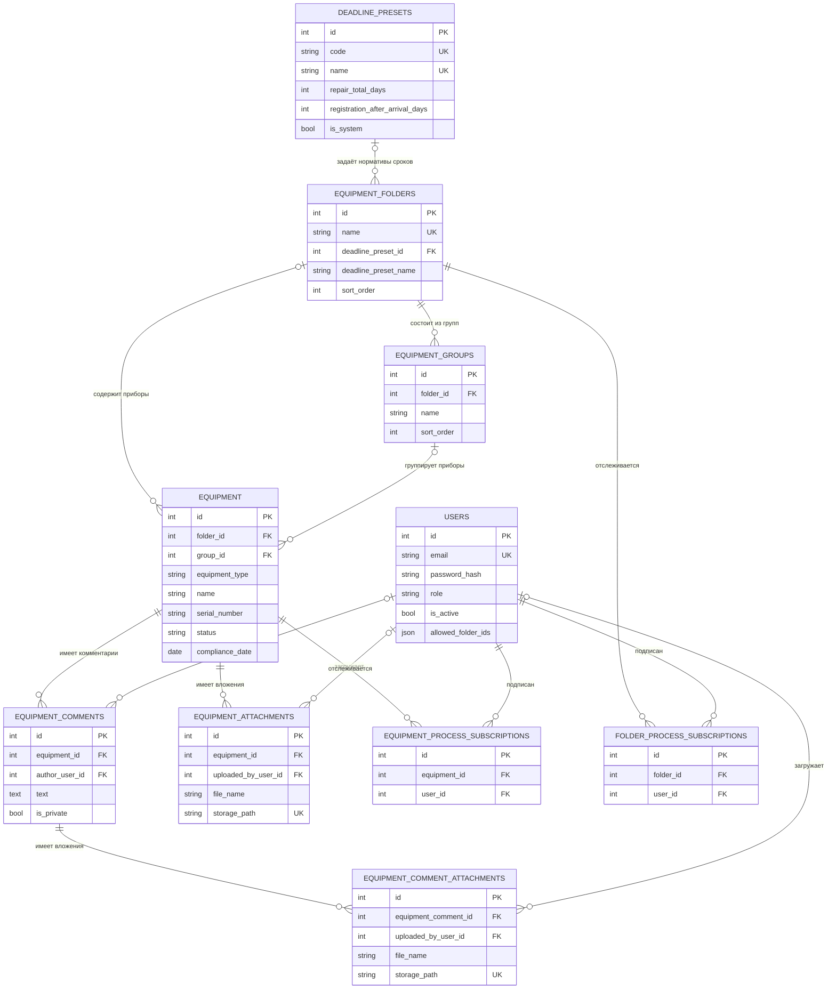
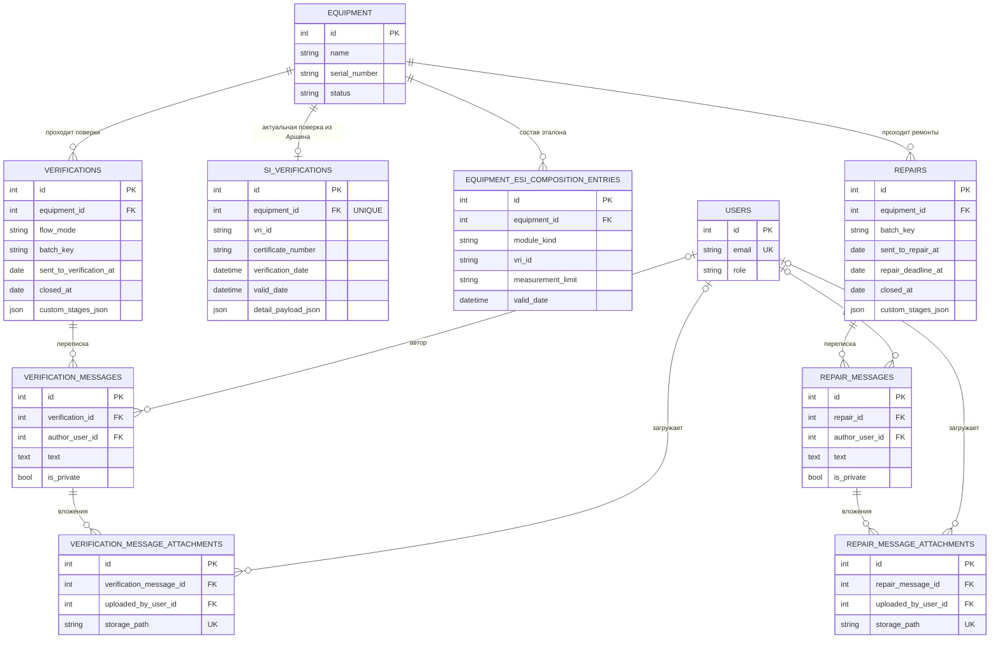
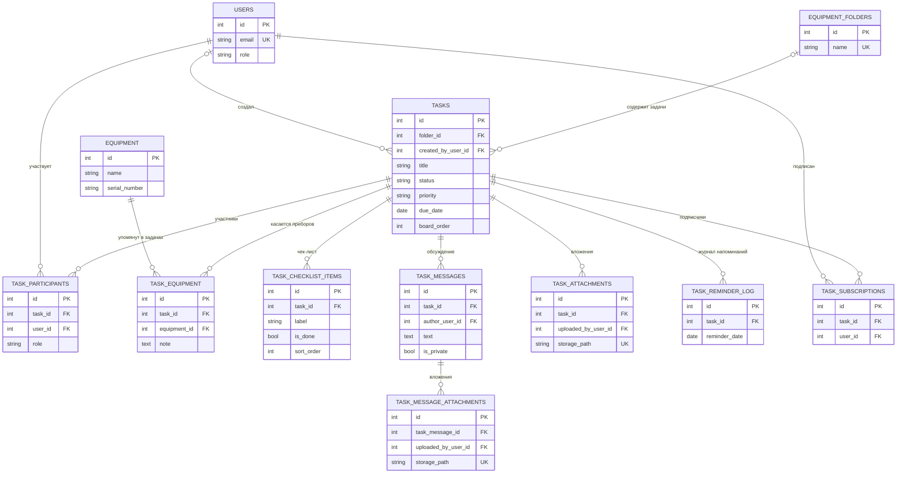
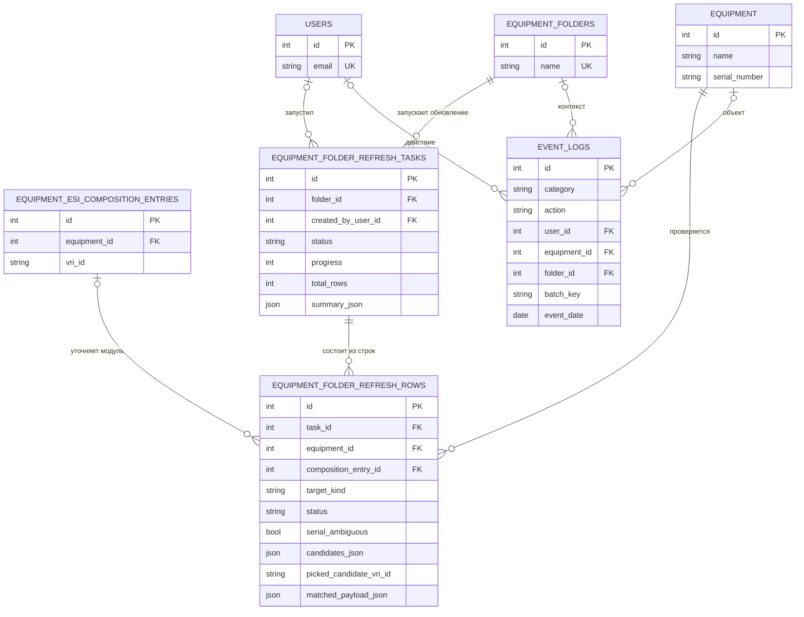

# ER-модель предметной области metroLog

**Дисциплина:** Разработка клиент-серверных приложений
**Проект:** metroLog — система учёта средств измерений и эталонов
**Студент:** Макеев Глеб Борисович, группа BHEBDPS-24-RKSP-5
**Дата:** 18.10.2026
**Версия кода:** 6ed7c5c (release v0.13.0)

---

## 1. Как получена модель

ER-модель **не рисовалась «по представлению»** — она снята с работающего кода и с реальной
схемы БД:

1. Прочитаны все модели SQLAlchemy: `backend/app/models/user.py`, `equipment.py`, `task.py`,
   `event.py` — 30 классов-сущностей.
2. Из моделей выписаны: имя таблицы (`__tablename__`), первичный ключ, внешние ключи
   (`ForeignKey` + `ondelete`), уникальные ограничения (`UniqueConstraint`) и индексы
   (`index=True`, `Index(...)`).
3. Модели сверены с фактической схемой: поднята пустая PostgreSQL 16, прогнаны все
   **66 миграций Alembic** (`alembic upgrade head`), схема снята `pg_dump --schema-only`.
   Расхождений «модель ↔ БД» нет; отдельно обнаружена устаревшая таблица `auth_codes`
   (миграция 0002), которой в моделях уже нет — она в ER не включена и помечена в SQL-скрипте.
4. Типы связей определены по ограничениям БД, а не по названиям полей: `NOT NULL` + `UNIQUE`
   на внешнем ключе = 1:1, обычный внешний ключ = 1:N, таблица-связка с двумя внешними ключами
   и составным `UNIQUE` = M:N.

Источник истины — код; если в тексте ниже написано «1:1», это значит, что в БД на колонке
действительно стоит уникальное ограничение.

---

## 2. Состав модели

30 сущностей, сгруппированных по предметным областям.

| Область | Сущности |
|---|---|
| Пользователи и доступ | `users`, `equipment_folders`, `equipment_process_subscriptions`, `folder_process_subscriptions` |
| Реестр оборудования | `deadline_presets`, `equipment_groups`, `equipment`, `equipment_attachments`, `equipment_comments`, `equipment_comment_attachments` |
| Поверка (СИ) | `verifications`, `verification_messages`, `verification_message_attachments`, `si_verifications`, `equipment_esi_composition_entries` |
| Ремонт | `repairs`, `repair_messages`, `repair_message_attachments` |
| Интеграция с ФГИС «Аршин» | `equipment_folder_refresh_tasks`, `equipment_folder_refresh_rows` |
| Задачи | `tasks`, `task_participants`, `task_equipment`, `task_checklist_items`, `task_messages`, `task_message_attachments`, `task_attachments`, `task_reminder_log`, `task_subscriptions` |
| Аудит | `event_logs` |

Ключевые перечисления (хранятся как `VARCHAR`, проверяются приложением):

- `users.role` — `DEVELOPER`, `ADMINISTRATOR`, `MKAIR`, `CUSTOMER`;
- `equipment.equipment_type` — `SI`, `ESI`, `IO`, `VO`, `OTHER`;
- `equipment.status` — `IN_WORK`, `IN_VERIFICATION`, `IN_REPAIR`, `REPAIRED`, `NOT_REPAIRABLE`, `ARCHIVED`;
- `verifications.flow_mode` — `OFFSITE_WITH_DEMOLITION`, `ONSITE_WITH_DEMOLITION`, `ONSITE_WITHOUT_DEMOLITION`;
- `tasks.status` / `tasks.priority` — `NEW…ARCHIVED` / `LOW…CRITICAL`;
- `event_logs.category` — `EQUIPMENT`, `REPAIR`, `VERIFICATION`, `TASK`.

---

## 3. ER-диаграммы (Mermaid)

### 3.1 Пользователи, доступ и реестр оборудования

**Пояснения к связям.**

- `equipment.folder_id` и `equipment.group_id` — **nullable** с `ON DELETE SET NULL`: прибор
  переживает удаление папки/группы и остаётся в реестре без привязки.
- `equipment_groups.folder_id` — `NOT NULL` с `ON DELETE CASCADE`: группа без папки
  существовать не может.
- `equipment_process_subscriptions` и `folder_process_subscriptions` — **M:N** между
  `users` и `equipment`/`equipment_folders`; каждая строка уникальна по паре
  (`UNIQUE (equipment_id, user_id)` и `UNIQUE (folder_id, user_id)`).
- Доступ по папкам для роли `CUSTOMER`/`MKAIR` хранится **не в таблице-связке**, а в
  JSON-массивах `users.allowed_folder_ids` / `hidden_equipment_folder_ids`. Это осознанная
  денормализация (см. раздел 6), из-за неё на `folder_id` в `users` нет внешнего ключа.

### 3.2 Поверка и ремонт

**Пояснения к связям.**

- `si_verifications` — **строго 1:1** с `equipment`: `UNIQUE (equipment_id)`, `ON DELETE CASCADE`.
  Это «последняя известная поверка СИ по данным Аршина», а не история.
- `verifications` и `repairs` — **1:N** к оборудованию: у прибора много процессов за годы,
  активный — тот, у которого `closed_at IS NULL` (в модели это `viewonly`-связи
  `Equipment.active_verification` / `active_repair`, в БД — частичные индексы
  `... WHERE closed_at IS NULL`).
- `batch_key` — не внешний ключ, а строковый ключ групповой операции: по нему
  собираются все поверки/ремонты, созданные одним batch-запросом. Поэтому связь
  «batch → строки» логическая, а не ссылочная.
- `equipment_esi_composition_entries` — состав эталона (внутренние/внешние модули),
  у каждой строки `UNIQUE (equipment_id, vri_id)`: один и тот же эталон не дублируется.

### 3.3 Задачи

**Пояснения к связям.**

- `tasks.folder_id` — nullable, `ON DELETE CASCADE` в БД, но задача может жить вне папки
  (личная задача) — это прямо задокументировано в модели.
- `task_participants` — **M:N с атрибутом**: `UNIQUE (task_id, user_id, role)`, то есть один
  человек может быть у задачи и ответственным, и исполнителем одновременно.
- `task_equipment` — **M:N** «задача ↔ оборудование» с полезной нагрузкой (`note`, `sort_order`),
  `UNIQUE (task_id, equipment_id)`.
- `task_reminder_log` — техническая таблица идемпотентности напоминаний:
  `UNIQUE (task_id, reminder_date)` гарантирует не более одного письма в день.

### 3.4 Обновление из ФГИС «Аршин» и журнал событий

**Пояснения к связям.**

- Задача обновления папки — **шапка + строки** (1:N, `ON DELETE CASCADE`): шапка хранит
  прогресс и сводку, строки — результат по каждому прибору
  (`UPDATED`, `UPDATED_UNCERTAIN`, `UNCHANGED`, `NOT_FOUND`, `ERROR`).
- `equipment_folder_refresh_rows` — снимок «что было в карточке на момент сверки»
  (`current_certificate_number`, `current_valid_date`) плюс «что нашлось в Аршине»
  (`matched_*`). Это аудит операции, а не нормализованные данные.
- `event_logs` — намеренно денормализованный журнал: хранит и `*_id` (с `ON DELETE SET NULL`),
  и текстовые копии (`equipment_name`, `folder_name`, `user_display_name`), чтобы запись
  читалась после удаления объекта.

### 3.5 Сводная схема связей (все сущности)

```mermaid
erDiagram
    USERS ||--o{ EQUIPMENT_PROCESS_SUBSCRIPTIONS : "подписка на прибор"
    USERS ||--o{ FOLDER_PROCESS_SUBSCRIPTIONS : "подписка на папку"
    USERS ||--o{ TASK_SUBSCRIPTIONS : "подписка на задачу"
    USERS ||--o{ TASK_PARTICIPANTS : "участник"
    USERS |o--o{ TASKS : "автор"
    USERS |o--o{ EVENT_LOGS : "автор действия"
    USERS |o--o{ EQUIPMENT_COMMENTS : "автор"
    USERS |o--o{ EQUIPMENT_ATTACHMENTS : "загрузил"
    USERS |o--o{ EQUIPMENT_COMMENT_ATTACHMENTS : "загрузил"
    USERS |o--o{ VERIFICATION_MESSAGES : "автор"
    USERS |o--o{ VERIFICATION_MESSAGE_ATTACHMENTS : "загрузил"
    USERS |o--o{ REPAIR_MESSAGES : "автор"
    USERS |o--o{ REPAIR_MESSAGE_ATTACHMENTS : "загрузил"
    USERS |o--o{ TASK_MESSAGES : "автор"
    USERS |o--o{ TASK_MESSAGE_ATTACHMENTS : "загрузил"
    USERS |o--o{ TASK_ATTACHMENTS : "загрузил"
    USERS |o--o{ EQUIPMENT_FOLDER_REFRESH_TASKS : "запустил"

    DEADLINE_PRESETS |o--o{ EQUIPMENT_FOLDERS : "нормативы"
    EQUIPMENT_FOLDERS ||--o{ EQUIPMENT_GROUPS : "группы"
    EQUIPMENT_FOLDERS |o--o{ EQUIPMENT : "приборы"
    EQUIPMENT_FOLDERS ||--o{ TASKS : "задачи"
    EQUIPMENT_FOLDERS ||--o{ FOLDER_PROCESS_SUBSCRIPTIONS : "подписки"
    EQUIPMENT_FOLDERS ||--o{ EQUIPMENT_FOLDER_REFRESH_TASKS : "обновления"
    EQUIPMENT_FOLDERS |o--o{ EVENT_LOGS : "контекст"

    EQUIPMENT_GROUPS |o--o{ EQUIPMENT : "приборы"

    EQUIPMENT ||--o| SI_VERIFICATIONS : "actual-поверка"
    EQUIPMENT ||--o{ EQUIPMENT_ESI_COMPOSITION_ENTRIES : "состав"
    EQUIPMENT ||--o{ VERIFICATIONS : "поверки"
    EQUIPMENT ||--o{ REPAIRS : "ремонты"
    EQUIPMENT ||--o{ EQUIPMENT_COMMENTS : "комментарии"
    EQUIPMENT ||--o{ EQUIPMENT_ATTACHMENTS : "вложения"
    EQUIPMENT ||--o{ EQUIPMENT_PROCESS_SUBSCRIPTIONS : "подписки"
    EQUIPMENT ||--o{ TASK_EQUIPMENT : "задачи"
    EQUIPMENT ||--o{ EQUIPMENT_FOLDER_REFRESH_ROWS : "сверки"
    EQUIPMENT |o--o{ EVENT_LOGS : "события"

    EQUIPMENT_COMMENTS ||--o{ EQUIPMENT_COMMENT_ATTACHMENTS : "вложения"
    VERIFICATIONS ||--o{ VERIFICATION_MESSAGES : "сообщения"
    VERIFICATION_MESSAGES ||--o{ VERIFICATION_MESSAGE_ATTACHMENTS : "вложения"
    REPAIRS ||--o{ REPAIR_MESSAGES : "сообщения"
    REPAIR_MESSAGES ||--o{ REPAIR_MESSAGE_ATTACHMENTS : "вложения"

    EQUIPMENT_FOLDER_REFRESH_TASKS ||--o{ EQUIPMENT_FOLDER_REFRESH_ROWS : "строки"
    EQUIPMENT_ESI_COMPOSITION_ENTRIES |o--o{ EQUIPMENT_FOLDER_REFRESH_ROWS : "модуль"

    TASKS ||--o{ TASK_PARTICIPANTS : "участники"
    TASKS ||--o{ TASK_EQUIPMENT : "приборы"
    TASKS ||--o{ TASK_CHECKLIST_ITEMS : "чек-лист"
    TASKS ||--o{ TASK_MESSAGES : "сообщения"
    TASKS ||--o{ TASK_ATTACHMENTS : "вложения"
    TASKS ||--o{ TASK_REMINDER_LOG : "напоминания"
    TASKS ||--o{ TASK_SUBSCRIPTIONS : "подписчики"
    TASK_MESSAGES ||--o{ TASK_MESSAGE_ATTACHMENTS : "вложения"
```

Обозначения Mermaid: `||` — ровно один, `|o` — ноль или один, `o{` — ноль или много,
`|{` — один или много. Читается слева направо: `EQUIPMENT ||--o| SI_VERIFICATIONS` —
«у одного прибора ноль или одна актуальная поверка, каждая такая поверка принадлежит
ровно одному прибору».

---

## 4. Сущности, ключи и связи (Crow's Foot словами)

| Сущность (таблица) | Первичный ключ | Внешние ключи / уникальность | Связи (Crow's Foot) |
|---|---|---|---|
| Пользователь (`users`) | `id` | `email` — UNIQUE | 1:N с комментариями, сообщениями, вложениями, задачами, событиями (автор, 0..*); M:N с оборудованием и папками через подписки |
| Папка (`equipment_folders`) | `id` | `name` — UNIQUE; `deadline_preset_id` → `deadline_presets.id` SET NULL | 1:N с группами (1..*), оборудованием (0..*), задачами (0..*), задачами обновления (0..*) |
| Нормативы сроков (`deadline_presets`) | `id` | `code`, `name` — UNIQUE | 0..1 : 0..* с папками (одна папка имеет 0..1 пресет, пресет используется 0..* папками) |
| Группа (`equipment_groups`) | `id` | `folder_id` → `equipment_folders.id` CASCADE; UNIQUE (`folder_id`, `name`) | 1:N с оборудованием (0..*); принадлежит ровно одной папке |
| Оборудование (`equipment`) | `id` | `folder_id` → `equipment_folders.id` SET NULL; `group_id` → `equipment_groups.id` SET NULL | 1:1 с `si_verifications` (0..1); 1:N с поверками, ремонтами, комментариями, вложениями, составом ЭСИ, строками обновления, событиями (0..*) |
| Actual-поверка (`si_verifications`) | `id` | `equipment_id` → `equipment.id` CASCADE, **UNIQUE** | ровно 1 прибор : 0..1 запись |
| Состав эталона (`equipment_esi_composition_entries`) | `id` | `equipment_id` CASCADE; UNIQUE (`equipment_id`, `vri_id`) | 1:N от оборудования; 0..1 : 0..* со строками обновления |
| Комментарий (`equipment_comments`) | `id` | `equipment_id` CASCADE; `author_user_id` SET NULL | 1:N от оборудования; 1:N к вложениям комментария; автор 0..1 |
| Вложение комментария (`equipment_comment_attachments`) | `id` | `equipment_comment_id` CASCADE; `storage_path` UNIQUE | принадлежит ровно одному комментарию |
| Вложение оборудования (`equipment_attachments`) | `id` | `equipment_id` CASCADE; `storage_path` UNIQUE | принадлежит ровно одному прибору |
| Поверка (`verifications`) | `id` | `equipment_id` → `equipment.id` CASCADE; `batch_key` (не FK) | 1:N от оборудования; 1:N к сообщениям; логическая группа по `batch_key` |
| Сообщение поверки (`verification_messages`) | `id` | `verification_id` CASCADE; `author_user_id` SET NULL | 1:N от поверки; 1:N к вложениям |
| Вложение сообщения поверки (`verification_message_attachments`) | `id` | `verification_message_id` CASCADE; `storage_path` UNIQUE | принадлежит ровно одному сообщению |
| Ремонт (`repairs`) | `id` | `equipment_id` → `equipment.id` CASCADE; `batch_key` (не FK) | 1:N от оборудования; 1:N к сообщениям; логическая группа по `batch_key` |
| Сообщение ремонта (`repair_messages`) | `id` | `repair_id` CASCADE; `author_user_id` SET NULL | 1:N от ремонта; 1:N к вложениям |
| Вложение сообщения ремонта (`repair_message_attachments`) | `id` | `repair_message_id` CASCADE; `storage_path` UNIQUE | принадлежит ровно одному сообщению |
| Задача обновления папки (`equipment_folder_refresh_tasks`) | `id` | `folder_id` CASCADE; `created_by_user_id` SET NULL | 1:N от папки; 1:N к строкам; автор 0..1 |
| Строка обновления (`equipment_folder_refresh_rows`) | `id` | `task_id` CASCADE; `equipment_id` CASCADE; `composition_entry_id` SET NULL | принадлежит ровно одной задаче и ровно одному прибору |
| Подписка на прибор (`equipment_process_subscriptions`) | `id` | UNIQUE (`equipment_id`, `user_id`) | M:N «пользователь ↔ прибор» |
| Подписка на папку (`folder_process_subscriptions`) | `id` | UNIQUE (`folder_id`, `user_id`) | M:N «пользователь ↔ папка» |
| Задача (`tasks`) | `id` | `folder_id` → `equipment_folders.id` CASCADE (nullable); `created_by_user_id` SET NULL | 1:N от папки (0..*); 1:N к участникам, чек-листу, сообщениям, вложениям, подпискам, напоминаниям |
| Участник задачи (`task_participants`) | `id` | UNIQUE (`task_id`, `user_id`, `role`) | M:N «задача ↔ пользователь» с атрибутом `role` |
| Задача ↔ прибор (`task_equipment`) | `id` | UNIQUE (`task_id`, `equipment_id`) | M:N «задача ↔ оборудование» с атрибутами `note`, `sort_order` |
| Пункт чек-листа (`task_checklist_items`) | `id` | `task_id` CASCADE | 1:N от задачи, упорядочен `sort_order` |
| Сообщение задачи (`task_messages`) | `id` | `task_id` CASCADE; `author_user_id` SET NULL | 1:N от задачи; 1:N к вложениям |
| Вложение сообщения задачи (`task_message_attachments`) | `id` | `task_message_id` CASCADE; `storage_path` UNIQUE | принадлежит ровно одному сообщению |
| Вложение задачи (`task_attachments`) | `id` | `task_id` CASCADE; `storage_path` UNIQUE | принадлежит ровно одной задаче |
| Журнал напоминаний (`task_reminder_log`) | `id` | UNIQUE (`task_id`, `reminder_date`) | 1:N от задачи; техническая идемпотентность |
| Подписка на задачу (`task_subscriptions`) | `id` | UNIQUE (`task_id`, `user_id`) | M:N «задача ↔ пользователь» |
| Журнал событий (`event_logs`) | `id` | `user_id`, `equipment_id`, `folder_id` — SET NULL; `batch_key` (не FK) | 0..1 : 0..* к пользователю, прибору, папке; запись живёт после удаления объекта |

### Промежуточные таблицы (M:N)

| Таблица-связка | Что связывает | Дополнительные атрибуты |
|---|---|---|
| `equipment_process_subscriptions` | `users` ↔ `equipment` | `created_at` |
| `folder_process_subscriptions` | `users` ↔ `equipment_folders` | `created_at` |
| `task_subscriptions` | `users` ↔ `tasks` | `created_at` |
| `task_participants` | `users` ↔ `tasks` | `role` (`RESPONSIBLE` / `ASSIGNEE` / `OBSERVER`) |
| `task_equipment` | `tasks` ↔ `equipment` | `note`, `sort_order` |

---

## 5. Правила ссылочной целостности

| Правило | Где применяется | Смысл |
|---|---|---|
| `ON DELETE CASCADE` | группы, поверки, ремонты, сообщения, вложения, строки обновления, участники задач | дочерняя запись не имеет смысла без родителя |
| `ON DELETE SET NULL` | `equipment.folder_id`, `equipment.group_id`, автор сообщения/вложения, `event_logs.*` | история и объекты сохраняются при удалении справочника/пользователя |
| `UNIQUE` на FK | `si_verifications.equipment_id` | гарантирует 1:1 на уровне БД, а не в коде |
| Составные `UNIQUE` | подписки, участники, `task_equipment`, `task_reminder_log`, `equipment_groups(folder_id,name)`, `equipment_esi_composition_entries(equipment_id,vri_id)` | запрет дублей связи |
| Частичные индексы | `repairs`, `verifications` — `WHERE closed_at IS NULL` / `IS NOT NULL` | быстрый доступ к активной очереди и архиву |

---

## 6. Нормализация

### 6.1 Первая нормальная форма (1НФ)

**Атрибуты атомарны** — да, за двумя осознанными исключениями:

- `users.allowed_folder_ids`, `hidden_equipment_folder_ids`, `dashboard_folder_ids`,
  `folder_order_ids`, `enabled_theme_options`, `tasks.tags` — JSON-массивы;
- `users.dashboard_layout`, `deadline_presets.*_stage_templates_json`,
  `repairs.custom_stages_json`, `verifications.custom_stages_json`,
  `equipment_folder_refresh_rows.candidates_json` — JSON-документы.

Формально это нарушение 1НФ (в ячейке — множество значений). Причины осознанные:

1. **Порядок важен.** `folder_order_ids` и `custom_stages_json` — упорядоченные списки;
   в реляционной таблице пришлось бы держать `sort_order` и переписывать пачку строк
   при каждом перетаскивании.
2. **Значение читается и пишется целиком.** Список доступных папок — это «скоуп»,
   который проверяется на каждом запросе; отдельная таблица дала бы JOIN в горячем пути.
3. **Схема внешней системы.** `raw_payload_json` / `detail_payload_json` — ответ ФГИС
   «Аршин» как есть; раскладывать его по колонкам пришлось бы заново при каждом
   изменении формата госреестра.

Цена: СУБД не может гарантировать ссылочную целостность таких списков (в `users.allowed_folder_ids`
может остаться id удалённой папки). Это компенсируется приложением — миграция
`0064_prune_deleted_folder_scopes` как раз чистит такие «висячие» id.

### 6.2 Вторая нормальная форма (2НФ)

**Соблюдается.** Во всех 30 таблицах первичный ключ — суррогатный `id` (integer, sequence),
составных первичных ключей нет. Значит, частичных зависимостей «неключевой атрибут зависит
от части ключа» быть не может. Таблицы-связки тоже имеют суррогатный `id`, а уникальность
пары обеспечивается отдельным `UNIQUE`-ограничением — это не нарушает 2НФ, но означает,
что естественный ключ продублирован (нормально для ORM-схем).

### 6.3 Третья нормальная форма (3НФ)

В целом **соблюдается**: справочники вынесены (`deadline_presets`), иерархия
«папка → группа → прибор» нормализована, перечисления не хранятся текстом в свободной форме.

Осознанные денормализации (транзитивные зависимости и дублирование) — все с конкретной целью:

| Место | Что дублируется | Зачем |
|---|---|---|
| `event_logs` | `equipment_name`, `equipment_modification`, `equipment_serial_number`, `folder_name`, `user_display_name` | аудит должен читаться после удаления прибора/папки/пользователя; FK при этом `SET NULL` |
| `repairs` | `repair_total_days_snapshot`, `registration_after_arrival_days_snapshot`, `incoming_control_after_receipt_days_snapshot`, `payment_after_control_days_snapshot` | сроки фиксируются в момент создания ремонта: изменение пресета не должно переписывать историю |
| `equipment_folders` | `deadline_preset_name`, `deadline_preset_snapshot_json` | пресет могут удалить (`deadline_preset_id` → `SET NULL`), а папка должна помнить, по каким нормативам работала |
| `equipment_folder_refresh_rows` | `equipment_name`, `equipment_serial_number`, `current_certificate_number`, `current_verification_date`, `current_valid_date` | снимок карточки на момент сверки — иначе отчёт «что изменилось» невозможно восстановить |
| `equipment_esi_composition_entries`, `si_verifications` | поля из Аршина (`org_title`, `mit_*`, `result_docnum`, даты) | кэш внешнего реестра: система работает, даже когда Аршин недоступен |
| `*_messages`, `equipment_comments`, `tasks` | `author_display_name`, `created_by_display_name` | подпись сообщения не должна меняться при смене фамилии или удалении пользователя |
| `users.allowed_folder_ids` и др. | id папок в JSON | см. 6.1: скорость проверки доступа и сохранение порядка |

Отдельно стоит зафиксировать **недостаток, а не денормализацию**: перечисления хранятся
как `VARCHAR` **без `CHECK`-ограничений**. На уровне БД нельзя вставить «несуществующий»
статус — но и нельзя запретить: целостность держится на `StrEnum` в SQLAlchemy и Pydantic.
Для учебного проекта это приемлемо, для строгой системы стоило бы добавить `CHECK` или
нативные `ENUM`-типы PostgreSQL.

### 6.4 Вывод по нормализации

Схема находится в **3НФ с документированными исключениями**. Все отклонения — либо
снимки истории (аудит, сроки, отчёты сверки), либо кэш внешней системы, либо
производительность горячего пути доступа. Ни одна денормализация не сделана «просто так»:
у каждой есть комментарий в коде или миграции.

---

## 7. Что не отражено в ER (и почему)

- `auth_codes` — таблица из миграции 0002 (коды подтверждения email). В моделях её нет,
  код её не использует; осталась в БД как исторический артефакт. В SQL-скрипт включена
  для полного совпадения с реальной базой.
- `alembic_version` — служебная таблица миграций, к предметной области не относится.
- Связь «пользователь ↔ разрешённые папки» существует только в JSON и поэтому на ER
  показана пунктиром словесно, а не линией.
- Очередь Redis/RQ и файловое хранилище вложений (`storage/...`) — не сущности БД;
  вложения ссылаются на файлы строкой `storage_path`.

---

## 8. Файлы

- `Практика 2/ER-диаграмма.md` — настоящий документ.
- `Практика 2/схема_БД.sql` — DDL PostgreSQL, снятый с прогона всех миграций.
- `Практика 2/Практика 2 — ER и схема БД.md` — отчёт по практике.
