# Практика 2. ER-диаграмма предметной области и схема базы данных

**Дисциплина:** Разработка клиент-серверных приложений
**Проект:** metroLog — система учёта средств измерений и эталонов
**Студент:** Макеев Глеб Борисович, группа BHEBDPS-24-RKSP-5
**Дата:** 18.10.2026
**Версия кода:** 6ed7c5c (release v0.13.0)
**Репозиторий:** https://github.com/mflkee/metroLog

---

## 1. Цель работы

Построить ER-модель предметной области «учёт средств измерений» по фактическим моделям
данных проекта metroLog, определить типы связей и ключи, получить SQL-схему базы данных
PostgreSQL и оценить степень нормализации.

Работа опирается на результаты практики 1: там зафиксированы роли, бизнес-процессы и
функциональные требования F1–F17. Здесь эти требования превращаются в структуру хранения.

---

## 2. Исходные данные и метод

| Источник | Что взято |
|---|---|
| `backend/app/models/user.py` | пользователи, роли, настройки интерфейса, скоуп папок |
| `backend/app/models/equipment.py` | реестр, папки, группы, поверки, ремонты, вложения, обновление из Аршина |
| `backend/app/models/task.py` | задачи, участники, чек-листы, сообщения, подписки |
| `backend/app/models/event.py` | журнал событий |
| `backend/alembic/versions/*.py` | 66 миграций — фактическая история схемы |
| `backend/app/services/*.py` | правила, которые не выражены в БД (скоуп папок, batch-операции) |

Метод: модели прочитаны построчно, затем схема **воспроизведена** — поднята пустая
PostgreSQL 16, выполнено `alembic upgrade head`, снят `pg_dump --schema-only`. Это позволило
не гадать о типах колонок и именах ограничений, а увидеть их.

---

## 3. Состав модели

Получено **30 сущностей** (30 таблиц в моделях). Плюс две служебные таблицы в реальной БД:
`alembic_version` и устаревшая `auth_codes` (осталась от миграции 0002, кодом не используется).

| Область | Сущности | Кол-во |
|---|---|---|
| Пользователи и доступ | `users`, `equipment_folders`, `equipment_process_subscriptions`, `folder_process_subscriptions` | 4 |
| Реестр | `deadline_presets`, `equipment_groups`, `equipment`, `equipment_comments`, `equipment_comment_attachments`, `equipment_attachments` | 6 |
| Поверка | `si_verifications`, `equipment_esi_composition_entries`, `verifications`, `verification_messages`, `verification_message_attachments` | 5 |
| Ремонт | `repairs`, `repair_messages`, `repair_message_attachments` | 3 |
| Интеграция с Аршином | `equipment_folder_refresh_tasks`, `equipment_folder_refresh_rows` | 2 |
| Задачи | `tasks`, `task_participants`, `task_equipment`, `task_checklist_items`, `task_messages`, `task_message_attachments`, `task_attachments`, `task_reminder_log`, `task_subscriptions` | 9 |
| Аудит | `event_logs` | 1 |

---

## 4. ER-диаграмма

Полная модель с атрибутами, ключами и пятью тематическими диаграммами —
в файле **`Практика 2/ER-диаграмма.md`**. Ниже — сводная схема связей.

```mermaid
erDiagram
    USERS ||--o{ EQUIPMENT_PROCESS_SUBSCRIPTIONS : "подписка на прибор"
    USERS ||--o{ FOLDER_PROCESS_SUBSCRIPTIONS : "подписка на папку"
    USERS ||--o{ TASK_SUBSCRIPTIONS : "подписка на задачу"
    USERS ||--o{ TASK_PARTICIPANTS : "участник"
    USERS |o--o{ TASKS : "автор"
    USERS |o--o{ EVENT_LOGS : "автор действия"
    USERS |o--o{ EQUIPMENT_COMMENTS : "автор"
    USERS |o--o{ EQUIPMENT_ATTACHMENTS : "загрузил"
    USERS |o--o{ VERIFICATION_MESSAGES : "автор"
    USERS |o--o{ REPAIR_MESSAGES : "автор"
    USERS |o--o{ TASK_MESSAGES : "автор"
    USERS |o--o{ EQUIPMENT_FOLDER_REFRESH_TASKS : "запустил"

    DEADLINE_PRESETS |o--o{ EQUIPMENT_FOLDERS : "нормативы"
    EQUIPMENT_FOLDERS ||--o{ EQUIPMENT_GROUPS : "группы"
    EQUIPMENT_FOLDERS |o--o{ EQUIPMENT : "приборы"
    EQUIPMENT_FOLDERS ||--o{ TASKS : "задачи"
    EQUIPMENT_FOLDERS ||--o{ FOLDER_PROCESS_SUBSCRIPTIONS : "подписки"
    EQUIPMENT_FOLDERS ||--o{ EQUIPMENT_FOLDER_REFRESH_TASKS : "обновления"
    EQUIPMENT_FOLDERS |o--o{ EVENT_LOGS : "контекст"

    EQUIPMENT_GROUPS |o--o{ EQUIPMENT : "приборы"

    EQUIPMENT ||--o| SI_VERIFICATIONS : "actual-поверка"
    EQUIPMENT ||--o{ EQUIPMENT_ESI_COMPOSITION_ENTRIES : "состав"
    EQUIPMENT ||--o{ VERIFICATIONS : "поверки"
    EQUIPMENT ||--o{ REPAIRS : "ремонты"
    EQUIPMENT ||--o{ EQUIPMENT_COMMENTS : "комментарии"
    EQUIPMENT ||--o{ EQUIPMENT_ATTACHMENTS : "вложения"
    EQUIPMENT ||--o{ EQUIPMENT_PROCESS_SUBSCRIPTIONS : "подписки"
    EQUIPMENT ||--o{ TASK_EQUIPMENT : "задачи"
    EQUIPMENT ||--o{ EQUIPMENT_FOLDER_REFRESH_ROWS : "сверки"
    EQUIPMENT |o--o{ EVENT_LOGS : "события"

    EQUIPMENT_COMMENTS ||--o{ EQUIPMENT_COMMENT_ATTACHMENTS : "вложения"
    VERIFICATIONS ||--o{ VERIFICATION_MESSAGES : "сообщения"
    VERIFICATION_MESSAGES ||--o{ VERIFICATION_MESSAGE_ATTACHMENTS : "вложения"
    REPAIRS ||--o{ REPAIR_MESSAGES : "сообщения"
    REPAIR_MESSAGES ||--o{ REPAIR_MESSAGE_ATTACHMENTS : "вложения"

    EQUIPMENT_FOLDER_REFRESH_TASKS ||--o{ EQUIPMENT_FOLDER_REFRESH_ROWS : "строки"
    EQUIPMENT_ESI_COMPOSITION_ENTRIES |o--o{ EQUIPMENT_FOLDER_REFRESH_ROWS : "модуль"

    TASKS ||--o{ TASK_PARTICIPANTS : "участники"
    TASKS ||--o{ TASK_EQUIPMENT : "приборы"
    TASKS ||--o{ TASK_CHECKLIST_ITEMS : "чек-лист"
    TASKS ||--o{ TASK_MESSAGES : "сообщения"
    TASKS ||--o{ TASK_ATTACHMENTS : "вложения"
    TASKS ||--o{ TASK_REMINDER_LOG : "напоминания"
    TASKS ||--o{ TASK_SUBSCRIPTIONS : "подписчики"
    TASK_MESSAGES ||--o{ TASK_MESSAGE_ATTACHMENTS : "вложения"
```

**Как читать.** `||` — ровно один, `|o` — ноль или один, `o{` — ноль или много.
Например, `EQUIPMENT ||--o| SI_VERIFICATIONS` означает: у прибора может быть ноль или одна
актуальная запись поверки, и каждая такая запись принадлежит ровно одному прибору.

---

## 5. Связи и промежуточные таблицы

### 5.1 Типы связей

| Тип | Пример | Чем обеспечен |
|---|---|---|
| **1:1** | `equipment` ↔ `si_verifications` | `UNIQUE (equipment_id)` в БД |
| **1:N** | `equipment_folders` → `equipment_groups` | `folder_id NOT NULL` + `ON DELETE CASCADE` |
| **1:N (nullable)** | `equipment_folders` → `equipment` | `folder_id NULL` + `ON DELETE SET NULL` |
| **1:N (история)** | `equipment` → `verifications`, `repairs` | обычный FK, активная запись — `closed_at IS NULL` |
| **M:N** | `users` ↔ `equipment` (подписки) | таблица-связка + составной `UNIQUE` |
| **M:N с атрибутом** | `tasks` ↔ `users` | `task_participants.role` |
| **Шапка–строки** | `equipment_folder_refresh_tasks` → `..._rows` | FK + `ON DELETE CASCADE` |
| **Логическая группа** | `verifications` / `repairs` по `batch_key` | строковый ключ, не FK |

### 5.2 Промежуточные таблицы

| Таблица | Связь | Дополнительные поля |
|---|---|---|
| `equipment_process_subscriptions` | пользователи ↔ оборудование | `created_at` |
| `folder_process_subscriptions` | пользователи ↔ папки | `created_at` |
| `task_subscriptions` | пользователи ↔ задачи | `created_at` |
| `task_participants` | пользователи ↔ задачи | `role` (RESPONSIBLE / ASSIGNEE / OBSERVER) |
| `task_equipment` | задачи ↔ оборудование | `note`, `sort_order` |

### 5.3 Особые случаи

- **Доступ по папкам** для ролей `CUSTOMER` и `MKAIR` хранится в JSON-массивах
  `users.allowed_folder_ids` и `hidden_equipment_folder_ids`, а не в таблице-связке.
  Это сделано ради скорости: скоуп проверяется на каждом запросе реестра.
  Цена — отсутствие FK-целостности; висячие id чистит миграция `0064`.
- **Batch-операции** не имеют таблицы «партия»: группа задаётся строкой `batch_key`,
  которую клиент получает при создании и передаёт в последующих запросах. Так проще:
  не нужна отдельная сущность, а операции остаются идемпотентными по ключу.

---

## 6. Ключи и ограничения

- **Первичные ключи** — суррогатные `id integer` (sequence) во всех 30 таблицах.
- **Естественные ключи** вынесены в `UNIQUE`: `users.email`, `equipment_folders.name`,
  `deadline_presets.code`, `deadline_presets.name`.
- **Составные `UNIQUE`** (17 ограничений) защищают от дублей связей и операций:
  `(task_id, user_id, role)`, `(task_id, equipment_id)`, `(equipment_id, vri_id)`,
  `(task_id, reminder_date)`, `(folder_id, name)` и др.
- **Внешние ключи** — 50 у таблиц моделей (всего в SQL-файле 51: ещё один у служебной `auth_codes`), с явной политикой удаления:
  - `CASCADE` — дочерние данные без родителя бессмысленны (сообщения, вложения, строки обновления);
  - `SET NULL` — история должна пережить удаление (автор сообщения, папка прибора, события аудита).
- **Индексы** — 76 у таблиц моделей (всего в файле 80, из них 2 уникальных и 8 частичных): активные и архивные очереди поверок/ремонтов
  индексируются отдельно (`WHERE closed_at IS NULL` / `IS NOT NULL`), что соответствует
  основным экранным запросам.
- **CHECK-ограничений нет.** Перечисления хранятся как `VARCHAR(16…48)`, допустимые значения
  задаются `StrEnum` в Python и валидируются Pydantic. Это сознательный компромисс:
  проще добавлять новые статусы миграцией кода, чем менять тип в БД. Минус — БД сама
  не защищает от «мусорного» значения при прямом SQL-доступе.

---

## 7. Схема базы данных (SQL)

Файл **`Практика 2/схема_БД.sql`** — DDL PostgreSQL 16, снятый с прогона всех 66 миграций:

- 32 таблицы (`30` моделей + `auth_codes` + `alembic_version`);
- 51 `FOREIGN KEY`, 17 `UNIQUE`, 80 индексов;
- последовательности (`SERIAL`), значения по умолчанию, `ON DELETE`-политики;
- шапка файла фиксирует, как и когда он получен.

Скрипт проверен: применён на пустую базу (`psql -v ON_ERROR_STOP=1`) — создаёт все 32 таблицы
без ошибок. Это значит, что файл самодостаточен и может быть использован для развёртывания
схемы без Alembic (например, в учебной среде).

---

## 8. Нормализация

| НФ | Оценка | Комментарий |
|---|---|---|
| **1НФ** | соблюдается с исключениями | JSON-массивы (`allowed_folder_ids`, `folder_order_ids`, `tags`) и JSON-снимки (`custom_stages_json`, `raw_payload_json`) формально не атомарны. Причины: порядок элементов, чтение целиком, формат внешней системы |
| **2НФ** | соблюдается | везде суррогатный PK, составных ключей нет → частичных зависимостей нет |
| **3НФ** | соблюдается с исключениями | справочники вынесены; дублирование — только снимки истории и кэш Аршина |

**Осознанные денормализации:**

1. `event_logs` хранит копии `equipment_name`, `folder_name`, `user_display_name` —
   аудит должен читаться после удаления объектов.
2. `repairs` хранит `*_snapshot` сроков — изменение пресета не должно переписывать историю.
3. `equipment_folders` хранит `deadline_preset_name` и JSON-снимок пресета — на случай
   удаления пресета (`deadline_preset_id` → `SET NULL`).
4. `equipment_folder_refresh_rows` хранит снимок карточки и найденную запись Аршина —
   это отчёт о сверке, а не оперативные данные.
5. `*_messages` и `tasks` хранят `author_display_name` — подпись не должна «прыгать»
   при смене фамилии или удалении пользователя.
6. `si_verifications` и `equipment_esi_composition_entries` дублируют поля Аршина —
   кэш внешнего реестра, чтобы система работала при недоступности ФГИС.

**Честный вывод:** схема в 3НФ, но не «учебно-стерильная». Все отклонения обоснованы
требованиями аудита, историчности и устойчивости к недоступности внешней системы. Главный
недостаток — отсутствие `CHECK` на перечислениях и JSON-скоуп папок без FK.

---

## 9. Вывод

- Построена ER-модель из **30 сущностей**, отражающая все бизнес-процессы практики 1:
  реестр, поверки, ремонты, задачи, интеграцию с Аршином, коммуникации и аудит.
- Определены типы связей: одна 1:1 (`equipment` ↔ `si_verifications`), множество 1:N,
  пять M:N через промежуточные таблицы (две из них — с полезными атрибутами).
- Получена рабочая SQL-схема PostgreSQL (32 таблицы, 51 FK, 80 индексов), проверенная
  применением на пустую базу.
- Схема нормализована до 3НФ; денормализации задокументированы и объяснены.
- Модель готова к следующему шагу — проектированию REST API и клиент-серверной архитектуры
  (практика 3).

---

## 10. Файлы работы

| Файл | Содержание |
|---|---|
| `Практика 2/ER-диаграмма.md` | ER-модель: 5 Mermaid-диаграмм, таблица ключей и связей Crow's Foot, нормализация, метод получения |
| `Практика 2/схема_БД.sql` | DDL PostgreSQL 16 (32 таблицы) |
| `Практика 2/Практика 2 — ER и схема БД.md` | настоящий отчёт |
