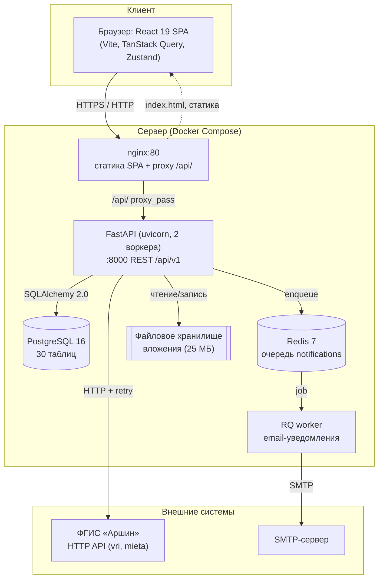

# Презентация: клиент-серверная архитектура metroLog

**Дисциплина:** Разработка клиент-серверных приложений
**Проект:** metroLog — система учёта средств измерений и эталонов
**Студент:** Макеев Глеб Борисович, группа BHEBDPS-24-RKSP-5
**Дата:** 18.10.2026
**Слайдов:** 14

> Файл-источник слайдов. PDF-версия: `Презентация — архитектура metroLog.pdf`,
> PowerPoint-версия: `Презентация — архитектура metroLog.pptx`.

---

## Слайд 1. Титульный

**metroLog — система учёта средств измерений и эталонов**

Клиент-серверная архитектура: React SPA → nginx → FastAPI → PostgreSQL / Redis

Дисциплина: «Разработка клиент-серверных приложений»
Студент: Макеев Глеб Борисович, группа BHEBDPS-24-RKSP-5
Преподаватель: Бучинский И. Н.
18.10.2026 · github.com/mflkee/metroLog

---

## Слайд 2. Проблема и назначение

**Как было (AS IS):**

- реестр СИ/ЭСИ — в разрозненных Excel-файлах по папкам и подразделениям;
- сроки поверки контролируются вручную по календарю → риск просрочки;
- данные из ФГИС «Аршин» переносятся руками → опечатки и дубли;
- статус прибора («в работе / на поверке / в ремонте / списан») нигде не агрегирован;
- нет разграничения доступа: файл передаётся целиком, заказчик видит лишнее.

**Назначение системы:** единая база измерительного оборудования, автоматический
контроль сроков, прозрачная история поверок и ремонтов, разграничение доступа
между исполнителями и заказчиками.

**Результат:** работающая система в эксплуатации (v0.13.0): 91 путь API, 124 операции,
18 экранов, 196 backend-тестов.

---

## Слайд 3. Пользователи и роли

| Роль | Код | Что может |
|---|---|---|
| Разработчик | `DEVELOPER` | поддержка и диагностика, полный доступ |
| Администратор | `ADMINISTRATOR` | пользователи, роли, права по папкам, справочники |
| Сотрудник МС | `MKAIR` | реестр, поверки, ремонты, переписка, отчёты |
| Заказчик | `CUSTOMER` | просмотр своих папок, комментарии, согласование |

Два уровня разграничения:

1. **Роль** — что за класс операций разрешён (чтение / оператор / администратор).
2. **Скоуп папок** — какие объекты доступны: белый список разрешённых и чёрный список скрытых.

При отсутствии доступа к объекту — **404**, а не 403: система не раскрывает
сам факт существования чужих данных.

---

## Слайд 4. Диаграмма развёртывания

**Один хост, пять контейнеров.** Наружу открыт только nginx: он раздаёт статику и
проксирует `/api/` на backend. PostgreSQL, Redis и воркер доступны только во внутренней
docker-сети; порты БД и Redis опубликованы лишь на loopback.

---

## Слайд 5. Компоненты и ответственность

| Слой | Технология | Зона ответственности |
|---|---|---|
| Клиент | React 19 + TypeScript, Vite, TanStack Query, Zustand, Tailwind | экраны, кэш серверных данных, состояние сессии и темы |
| Шлюз | nginx 1.27 | статика SPA, `try_files` для клиентской маршрутизации, proxy `/api/`, буферизация off для загрузок |
| API | FastAPI + Pydantic | маршрутизация, валидация, OpenAPI, зависимости (аутентификация, БД) |
| Логика | сервисный слой (18 модулей) | бизнес-правила: скоуп папок, процессы, batch-операции, уведомления |
| Данные | SQLAlchemy 2.0 + Alembic | ORM, миграции, транзакции, репозитории |
| Фон | Redis 7 + RQ | email-уведомления, повторные попытки, fallback в синхронную отправку |
| БД | PostgreSQL 16 | 30 таблиц, 50 FK, 76 индексов (8 частичных) |

Ключевое решение: **бизнес-логика не в эндпоинтах, а в сервисах** — роутер отвечает
только за HTTP-контракт, поэтому правила доступа и процессов тестируются отдельно от
транспорта.

---

## Слайд 6. Поток данных: вход в систему

1. Клиент: `POST /api/v1/auth/login` `{email, password}`.
2. FastAPI: валидация Pydantic → `AuthService.login()`.
3. Проверка пароля — PBKDF2-HMAC-SHA256, 600 000 итераций, соль 16 байт.
   (Опционально — проверка во внешнем реестре учётных записей metroAccounts.)
4. Сервер формирует токен: `base64url(payload).base64url(HMAC-SHA256(payload, secret))`,
   payload = `{sub, role, iat, exp}`.
5. Ответ: `200 {access_token, user}`; клиент кладёт токен в стор и подставляет
   `Authorization: Bearer <token>` во все запросы.
6. На каждом запросе — зависимость `get_current_user`: проверка подписи → загрузка
   пользователя → проверка `is_active`.

**Stateless:** сервер не хранит сессии. Отзыв доступа = блокировка пользователя
(проверяется на каждом запросе) или ротация секретного ключа (гасит все сессии).

---

## Слайд 7. Поток данных: CRUD оборудования

| Операция | Запрос | Что происходит на сервере |
|---|---|---|
| Список | `GET /api/v1/equipment/page?limit=&offset=&search=&sort=` | проверка скоупа папок → SQL с пагинацией → проекция в `EquipmentRead` |
| Чтение | `GET /api/v1/equipment/{id}` | доступ к папке прибора → 404 при отказе → карточка с деталями |
| Создание | `POST /api/v1/equipment` | валидация → вставка → запись в `event_logs` → 201 с карточкой |
| Изменение | `PATCH /api/v1/equipment/{id}` | частичное обновление (Pydantic `exclude_unset`) → событие аудита |
| Удаление | `DELETE /api/v1/equipment/{id}` | каскад процессов и вложений → событие аудита → 204 |
| Массово | `POST /api/v1/equipment/delete-batch` | удаление пачки с одним событием на каждую сущность |

Особенности:

- **все** запросы к реестру проходят через фильтр скоупа — на уровне сервиса, а не UI;
- списки всегда постраничные (`limit`/`offset`), тяжёлые выгрузки — в XLSX;
- каждое изменение оставляет след в журнале событий с текстовыми копиями названий,
  поэтому запись читается даже после удаления объекта.

---

## Слайд 8. Поток данных: Аршин и поверка

**Поиск и импорт из ФГИС «Аршин»**

1. `POST /api/v1/arshin/search` — поиск по свидетельству, рег. номеру или типу прибора.
2. Клиент `ArshinClient`: таймаут 30 с, до 5 попыток с экспоненциальной задержкой
   (2 → 45 с) — госреестр отвечает нестабильно.
3. `GET /api/v1/arshin/vri/{vri_id}` — детализация; ответ сохраняется в
   `si_verifications` вместе с исходным `raw_payload_json`.
4. **Пакетное обновление папки:** `POST /api/v1/equipment/folders/{id}/refresh-tasks`
   → создаётся задача-шапка, фоновая задача проходит по приборам и пишет строку
   на каждый: `UPDATED` / `UPDATED_UNCERTAIN` / `UNCHANGED` / `NOT_FOUND` / `ERROR`.
5. Если заводской номер неоднозначен (короткий номер встречается у десятков приборов),
   строка получает `serial_ambiguous=true` и список кандидатов; оператор выбирает
   запись в интерфейсе, и применяется ровно выбранная.

**Поверка СИ**

`POST /equipment/{id}/verification` → режим (выездная/на месте, с демонтажом или без),
маршрут, сроки → этапы и переписка с вложениями → `.../verification/close`.
Групповые операции: `POST /equipment/verifications/bulk` + `PATCH .../batch/{batch_key}`.

---

## Слайд 9. Доступ: RBAC и папки

**Три уровня проверки**

| Уровень | Где | Пример |
|---|---|---|
| Аутентификация | `get_current_user` | нет токена → 401; пользователь заблокирован → 401 |
| Роль | `require_admin` / `require_operator` | `CUSTOMER` не может создать прибор → 403 |
| Скоуп папок | `is_folder_access_allowed` в сервисах | нет доступа к папке → 404 |

**Скоуп папок**

- `DEVELOPER` и `ADMINISTRATOR` — видят всё (скоуп не ограничен);
- `MKAIR` и `CUSTOMER` — только `allowed_folder_ids`, минус `hidden_equipment_folder_ids`;
- проверка применяется и к спискам, и к одиночным объектам, и к вложенным сущностям
  (поверки, ремонты, комментарии, задачи);
- при отказе возвращается «Объект не найден» — **soft-denial**.

**Почему 404, а не 403:** 403 подтверждает существование объекта. Для заказчиков
метрологической службы сам факт наличия чужого прибора — коммерческая информация.

---

## Слайд 10. API-контракт

**Стиль:** REST поверх HTTP/1.1, JSON, версия в пути — `/api/v1`.

| Метод | Пример | Смысл |
|---|---|---|
| `POST` | `/api/v1/auth/login` | вход, выдача токена |
| `GET` | `/api/v1/equipment/page?limit=50&offset=0&folder_id=3` | постраничный список |
| `GET` | `/api/v1/equipment/{equipment_id}` | карточка |
| `POST` | `/api/v1/equipment` | создание (201 + созданная карточка) |
| `PATCH` | `/api/v1/equipment/{equipment_id}` | частичное изменение |
| `DELETE` | `/api/v1/equipment/{equipment_id}` | удаление (204) |
| `PUT` | `/api/v1/equipment/folders/{folder_id}/process-subscriptions` | идемпотентная замена подписок |
| `POST` | `/api/v1/equipment/verifications/bulk` | групповая операция |

**Коды ответов:** `200/201/204` — успех, `400` — бизнес-ошибка валидации, `401` —
не аутентифицирован, `403` — недостаточно прав, `404` — нет объекта или нет доступа,
`503` — недоступна БД/Redis (ready-проверка).

**Инструменты контракта:**

- OpenAPI 3 генерируется FastAPI автоматически: `/docs` (Swagger UI), `/redoc`,
  `/api/v1/openapi.json` — 91 путь, 124 операции;
- `slumber.yml` — коллекция запросов к ФГИС «Аршин» (vri/mieta: поиск по свидетельству,
  по типу и заводскому номеру, детализация);
- демонстрация: Swagger UI + Postman/REST-клиент по сценарию «логин → создание
  оборудования → поверка → закрытие».

---

## Слайд 11. Фоновые задачи, миграции, эксплуатация

**Фоновые задачи (Redis + RQ)**

- очередь `notifications`, воркер `python -m app.tasks.worker` отдельным контейнером;
- задачи: письмо-упоминание, письмо о событии процесса, уведомление по подпискам,
  выдача временного пароля;
- таймаут задачи 120 с, TTL результата 300 с, TTL ошибки 24 ч;
- **fallback:** если Redis недоступен, письмо отправляется синхронно — уведомление
  не теряется;
- напоминания по срокам задач — отдельный идемпотентный прогон
  (`python -m app.tasks.task_reminders`, `UNIQUE (task_id, reminder_date)`);
- пакетное обновление папки — `BackgroundTasks` с сохранением прогресса в БД.

**Миграции:** Alembic, 66 ревизий, `alembic upgrade head` выполняется при старте
контейнера backend до запуска приложения. Схема версионируется вместе с кодом.

**Эксплуатация:** `/api/v1/health` — живость процесса; `/api/v1/health/ready` — проверки
БД (`SELECT 1`) и Redis, при недоступности → `503`. Контейнеры с `restart: unless-stopped`,
перед деплоем — `pg_dump` базы.

---

## Слайд 12. Тестирование и нагрузка

**Автотесты**

| Уровень | Инструмент | Объём |
|---|---|---|
| Backend API и сервисы | pytest + httpx ASGI (in-memory SQLite) | **196 тестов** в 10 файлах |
| Frontend-логика | vitest + Testing Library | **33 файла** тестов |
| Линт и типы | ruff, mypy, eslint, `tsc --noEmit` | в CI на каждый push |

Проверяются: аутентификация и роли (24 теста), реестр и процессы (89), задачи (21),
сопоставление записей Аршина (15), интеграция учётных записей (23), шаблоны этапов (7),
health (2), клиент и сервис Аршина (13).

**Нагрузочные тесты (Locust, read-профиль, production-конфигурация)**

| Метрика | 30 пользователей | 60 пользователей |
|---|---|---|
| Запросов / RPS | 2 311 / 19,3 | 3 255 / 27,3 |
| Ошибки | **0** | **0** |
| p50 | 53 мс | 660 мс |
| p95 | 1,4 с | 2,4 с |
| Максимум | 6,1 с | 25,5 с |

Найденный потолок: `POST /auth/login` — PBKDF2 600 000 итераций считается прямо в
event loop и блокирует воркер. Вывод: для заявленного профиля (десятки пользователей)
запаса хватает, но хеширование нужно вынести в пул потоков.

---

## Слайд 13. CI/CD

**Схема:** push в `main` → проверки → сборка образов → деплой на staging.
Релизная ветка `release/X.Y.Z` → тот же конвейер → деплой на production → ветка удаляется.

| Стадия | Что делает |
|---|---|
| `checks` | ruff, pytest с покрытием, eslint, vitest, статический guard UI |
| `version-guard` | версия в `frontend/package.json` и корневом `package.json` обязана совпадать |
| `build-images` | сборка backend и frontend, публикация в `ghcr.io/mflkee/metrolog-*` (теги `sha-*`, `staging`/`latest`) |
| `runner-preflight` | ждёт self-hosted runner `mkair-runner`, иначе падает с понятным сообщением |
| `deploy-staging` | `docker compose pull && up -d` на порту 9000, проверка `/health/ready` |
| `deploy-prod` | `pg_dump` → `compose pull/up` → health-проверка → удаление release-ветки |

**Что это даёт:** сломанный тест или разошедшаяся версия физически не попадают на прод;
перед каждым прод-деплоем автоматически снимается резервная копия БД.

---

## Слайд 14. Что осталось и выводы

**Сделано**

- единая БД (30 таблиц, 3НФ с документированными денормализациями);
- REST API: 91 путь, 124 операции, OpenAPI и Swagger;
- веб-клиент: 18 экранов (реестр, поверки, ремонты, задачи, Аршин, аудит, админка);
- интеграция с ФГИС «Аршин» с ретраями и пакетным обновлением;
- 196 pytest + 33 vitest, нагрузочные тесты, CI/CD с деплоем.

**Осталось**

1. **Второй протокол взаимодействия** (кроме HTTP/REST) — для оценки «4»: SMTP уже
   используется, но требуется уточнить у преподавателя его зачёт; альтернатива —
   WebSocket/SSE для реалтайм-уведомлений.
2. **Фикс PBKDF2**: вынести `hash_password`/`verify_password` в `anyio.to_thread.run_sync`
   и перепрогнать нагрузочный тест — узкое место найдено на 60 пользователях.
3. **Тесты на устойчивость**: больше сценариев 4xx/5xx, некорректные токены, падение
   внешнего Аршина.
4. **Демонстрация** по сценарию приёмки (см. ТЗ, раздел 11.6).

**Вывод:** спроектированная и реализованная клиент-серверная архитектура закрывает
требования практики 1, подтверждена тестами и нагрузочными прогонами и работает
в реальной эксплуатации.
