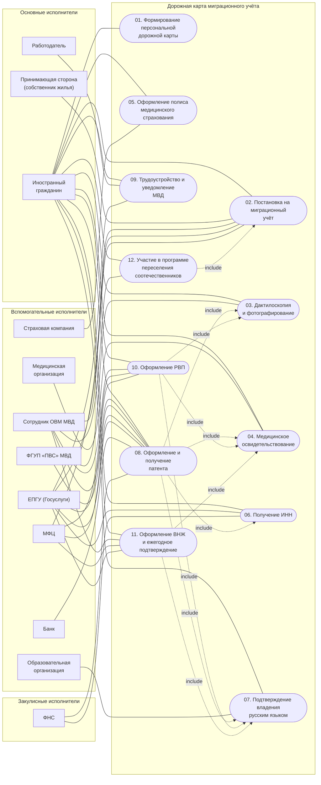

# Лабораторная 1. Определение прецедентов

**Дисциплина:** Функциональное моделирование систем
**Преподаватель:** Ткаченко И. Н., ТюмГУ
**Задание:** на основе описания предметной области определить функциональные требования в виде
диаграммы прецедентов со спецификацией (описание, основной исполнитель, основной сценарий,
альтернативные сценарии, при необходимости — предусловия и постусловия).

## Что в этой папке

| Файл | Что внутри |
|---|---|
| `README.md` | этот отчёт: предметная область, границы системы, перечень прецедентов, решения и открытые вопросы |
| `actors.md` | таблица акторов с типами (основной / вспомогательный / закулисный) |
| `usecase-diagram.md` | диаграмма прецедентов в Mermaid (рендерится на GitHub) |
| `usecase-diagram.puml` | та же диаграмма на PlantUML (+ отрендеренный `usecase-diagram.png`) |
| `usecases/01…12-*.md` | 12 спецификаций прецедентов в развёрнутом формате |

## 1. Предметная область

Исходный документ — «Дорожная карта» (`Дорожная карта [kmURdL].docx`): персональный план
действий иностранного гражданина (ИГ) в РФ. Она строится по анкете (гражданство, цель и дата
въезда, срок пребывания, статус, состав семьи) и разбита на 11 разделов — от постановки на
миграционный учёт до вида на жительство.

Ключевая особенность предметной области: **набор и сроки шагов зависят от профиля ИГ**, а не
заданы единым списком.

- **Гражданство** меняет срок постановки на миграционный учёт: 90 дней (Беларусь, Украина,
  ВКС и члены семей), 30 дней (Киргизия, Казахстан, Армения, участники программы), 15 дней
  (Таджикистан, Узбекистан), 7 дней (все остальные).
- **Цель въезда** меняет срок дактилоскопии и медосвидетельствования: 30 дней для трудовой
  цели, 90 дней для иных целей при пребывании свыше 90 суток.
- **Статус** исключает целые ветки: ВКС и участники программы переселения не оформляют патент,
  а трудоустраиваются по договору; наличие диплома РФ или аттестата до 1991 года снимает
  требование сертификата о владении русским языком.
- **Сроки** заданы в разных единицах — календарные и рабочие дни. Это не косметическая деталь:
  от неё зависит дата «не позднее» и, значит, корректность всей карты.

### 1.1. Участники процесса (по документу)

ИГ; лицо, у которого он проживает (собственник помещения), — направляет уведомление о
постановке на миграционный учёт; подразделения по вопросам миграции МВД и ФГУП «ПВС» МВД;
МФЦ и портал госуслуг; медицинские организации; страховая компания; образовательная
организация (экзамен по русскому языку, истории и основам законодательства); ФНС (ИНН,
НДФЛ); банк (авансовый платёж); работодатель.

Типы акторов и обоснование — в [`actors.md`](actors.md).

### 1.2. Документы и результаты, которые фигурируют в предметной области

| Результат шага | Кто выдаёт / принимает | Где используется дальше |
|---|---|---|
| Документ о постановке на миграционный учёт (отрывная часть уведомления) | ОВМ МВД (через ЕПГУ, МФЦ, лично) | дактилоскопия, медосвидетельствование, патент, РВП, ВНЖ |
| Результат дактилоскопии и фотографирования | ОВМ МВД, ФГУП «ПВС» | патент, РВП, ВНЖ |
| Медицинское заключение | медицинская организация | патент, РВП, ВНЖ |
| Полис ОМС/ДМС | страховая компания | трудоустройство |
| ИНН | ФНС | патент, уплата НДФЛ, договор |
| Сертификат о владении русским языком, знании истории и основ законодательства | образовательная организация | патент, РВП, ВНЖ |
| Патент | ОВМ МВД, ФГУП «ПВС» | трудовой договор, уведомление МВД |
| Трудовой договор / договор ГПХ | работодатель | уведомление МВД, НДФЛ |
| Уведомление МВД о трудовой деятельности | работодатель (ЕПГУ, почта) | контроль законности |
| РВП, ВНЖ | ОВМ МВД | проживание, работа, регистрация |

### 1.3. Нормативные сроки (из дорожной карты)

| № раздела | Шаг | Срок | Для кого |
|---|---|---|---|
| 1.1 | Миграционный учёт | 90 дней со дня въезда | Беларусь, Украина, ВКС и члены семей |
| 1.2 | Миграционный учёт | 30 дней со дня въезда (при смене места — с даты прибытия по новому адресу) | Киргизия, Казахстан, Армения, ВКС; смена регистрации |
| 1.3 | Миграционный учёт | 15 дней со дня въезда | Таджикистан, Узбекистан |
| 1.4 | Миграционный учёт | 7 дней со дня въезда | все остальные |
| 1.5 | Миграционный учёт | 30 дней со дня прибытия | участники программы переселения |
| 2.1 | Дактилоскопия и фотографирование | 30 календарных дней со дня въезда либо при обращении за патентом, если раньше | трудовая цель, ранее не проходили |
| 2.2 | Дактилоскопия и фотографирование | 90 календарных дней со дня въезда | иные цели, пребывание свыше 90 суток |
| 3.1 | Медосвидетельствование | 30 календарных дней со дня въезда либо при подаче на патент / разрешение на работу | трудовая цель |
| 3.2 | Медосвидетельствование | 90 календарных дней со дня въезда | иные цели, свыше 90 суток |
| 3.3 | Полис ОМС/ДМС | до начала трудовой деятельности | Азербайджан, Таджикистан, Узбекистан, Молдова, Украина, Киргизия, Казахстан, Армения |
| 4.1 | Заявление на патент | 30 дней со дня въезда | Азербайджан, Таджикистан, Узбекистан, Молдова, Украина (без ВКС и программы) |
| 4.2 | Трудовой договор / ГПХ | 2 месяца со дня въезда | ВКС и члены семей |
| 5.1 | Сертификат (экзамен) | до подачи заявления на патент | те же, при отсутствии документа об образовании |
| 5.3 | ИНН | до подачи заявления на патент | те же, при отсутствии ИНН |
| 6.1 | Авансовый платёж НДФЛ | до подачи заявления на патент | те же, кроме ВКС и участников программы |
| 6.2 | Подача заявления на патент | 30 дней со дня въезда | те же |
| 6.3 | Получение патента | 45 календарных дней со дня въезда | те же |
| 7.1 | Трудовой договор / ГПХ | 2 месяца с даты выдачи патента | получившие патент, но не трудоустроенные |
| 7.2 | Уведомление МВД о трудовой деятельности | после заключения договора, не позднее 2 месяцев с даты выдачи патента | получившие патент и трудоустроенные |
| 8.1 | Документы участника программы | 5 рабочих дней со дня прибытия | участники программы и члены семей |
| 8.2 | Постановка на учёт участника | 10 рабочих дней со дня прибытия | участники программы |
| 9.1 | Меры господдержки | 15 рабочих дней со дня прибытия | участники программы |
| 9.2 | Компенсация расходов | в течение года со дня въезда | участники программы |
| 10.1–10.2 | РВП: документы и заявление | 30 календарных дней со дня въезда | планирующие проживание свыше 90 суток |
| 10.3 | Регистрация по месту проживания после РВП | 7 рабочих дней со дня получения | получившие РВП |
| 11.1 | ВНЖ: документы | 30 календарных дней со дня возникновения основания | планирующие проживание свыше 3 лет |
| 11.2 | ВНЖ: подача | 10 рабочих дней со дня подготовки комплекта | те же |
| 11.3 | Ежегодное подтверждение проживания | 60 календарных дней после каждой годовщины выдачи | имеющие ВНЖ |

## 2. Границы системы

**В систему входит:** анкетирование и определение применимых требований; построение и
перестроение персональной карты; расчёт сроков (календарные/рабочие дни); ведение
электронного дела (документы, сканы, реквизиты, история); подготовка заявлений и комплектов;
подача через ЕПГУ/МФЦ и фиксация результата; контроль сроков и напоминания; уведомления
ИГ, принимающей стороны и работодателя; отображение статуса шагов.

**В систему не входит** (делегируется внешним исполнителям): сама дактилоскопия и
фотографирование, медицинское освидетельствование, приём экзамена и выдача сертификата,
страхование, приём платежей, принятие решений о выдаче патента / РВП / ВНЖ, ведение
ведомственных реестров, постановка на учёт в качестве участника программы.

Это разделение и определяет типы акторов: МВД, медорганизация, страховая, образовательная
организация, банк, ФНС — вспомогательные (обслуживают систему), а не основные.

## 3. Прецеденты

| ID | Прецедент | Основной исполнитель | Уровень | Файл |
|---|---|---|---|---|
| П01 | Формирование персональной дорожной карты | Иностранный гражданин | задача пользователя | [`usecases/01-…`](usecases/01-formirovanie-dorozhnoy-karty.md) |
| П02 | Постановка на миграционный учёт по месту пребывания | Принимающая сторона | задача пользователя | [`usecases/02-…`](usecases/02-migracionnyy-uchet.md) |
| П03 | Дактилоскопия и фотографирование | Иностранный гражданин | задача пользователя | [`usecases/03-…`](usecases/03-daktiloskopiya.md) |
| П04 | Медицинское освидетельствование | Иностранный гражданин | задача пользователя | [`usecases/04-…`](usecases/04-medosvidetelstvovanie.md) |
| П05 | Оформление полиса медицинского страхования | Иностранный гражданин | вспомогательная | [`usecases/05-…`](usecases/05-polis-medicinskogo-strahovaniya.md) |
| П06 | Получение ИНН | Иностранный гражданин | вспомогательная | [`usecases/06-…`](usecases/06-inn.md) |
| П07 | Подтверждение владения русским языком | Иностранный гражданин | задача пользователя | [`usecases/07-…`](usecases/07-ekzamen-russkiy-yazyk.md) |
| П08 | Оформление и получение патента | Иностранный гражданин | задача пользователя | [`usecases/08-…`](usecases/08-patent.md) |
| П09 | Трудоустройство и уведомление МВД | Работодатель | задача пользователя | [`usecases/09-…`](usecases/09-trudoustroystvo-i-uvedomlenie.md) |
| П10 | Оформление РВП | Иностранный гражданин | задача пользователя | [`usecases/10-…`](usecases/10-rvp.md) |
| П11 | Оформление ВНЖ и ежегодное подтверждение | Иностранный гражданин | задача пользователя | [`usecases/11-…`](usecases/11-vnzh.md) |
| П12 | Участие в программе переселения соотечественников | Иностранный гражданин | задача пользователя | [`usecases/12-…`](usecases/12-programma-pereseleniya.md) |

Итого **12 прецедентов**, каждый — в развёрнутом формате по лекции: название, рамки, уровень,
основной исполнитель, заинтересованные лица и их интересы, предусловия, постусловия,
основной успешный сценарий (две колонки: действия исполнителя / отклик системы),
альтернативные сценарии с нумерацией `Nа`, `*а` для сквозных условий, специальные требования,
частота использования, открытые вопросы.

### 3.1. Соответствие разделам дорожной карты

| Раздел документа | Прецедент |
|---|---|
| 1. Миграционный учёт | П02 |
| 2. Дактилоскопия и фотографирование | П03 |
| 3. Медосвидетельствование и страхование | П04, П05 |
| 4. Выбор порядка трудоустройства | правило в П01; ветки — П08 (патент) и П09 (ВКС, договор) |
| 5. Подготовка документов для патента | П07 (сертификат), П06 (ИНН); фото 3 × 4 — шаг П08 |
| 6. Подача заявления и получение патента | П08 |
| 7. Действия после получения патента | П09 |
| 8. Постановка на учёт по программе переселения | П12 |
| 9. Меры государственной поддержки | П12 |
| 10. Получение РВП | П10 |
| 11. Получение ВНЖ | П11 |

## 4. Диаграмма прецедентов

Mermaid не умеет UML use case, поэтому использован `flowchart`: акторы — прямоугольники в
группах по типу, прецеденты — узлы-эллипсы `([ ])` внутри границы системы, сплошная линия —
ассоциация, пунктир с подписью `include` — обязательное включение. Пояснения к каждой связи —
в [`usecase-diagram.md`](usecase-diagram.md).

Проверка: PlantUML-версия отрендерена локально (`plantuml -checkonly` + `-tpng`),
Mermaid-версия проверена вручную на соответствие синтаксису `flowchart`
(подписи в кавычках, ` `, `-.->|include|`).

## 5. Решения по моделированию

1. **Рамки — одна система, а не организация.** Прецеденты описывают использование личного
   кабинета и его интеграций, а не работу МВД: поэтому «выдать патент» — не прецедент системы,
   а действие внешнего исполнителя, фиксируемое как результат.
2. **12 прецедентов, а не 30.** Шаги «сфотографироваться 3 × 4», «уплатить аванс», «проверить
   данные в патенте» не выделены отдельно: по критерию размера они выполняются за один шаг, а
   по критерию ЕБР не дают самостоятельного устойчивого результата. Они вошли в сценарии П08.
3. **«Регистрация в системе» и «ведение справочника» не прецеденты.** Не проходят критерий
   одобрения руководством: это не задача пользователя, а условие работы (см. `actors.md`).
4. **Патент, РВП, ВНЖ — раздельные прецеденты, хотя сценарии похожи.** У них разные основания,
   разные комплекты документов, разные сроки и разные результаты; объединение в «управление
   разрешительными документами» потеряло бы эти различия.
5. **`include`, а не `extend`.** Зависимости «патент → дактилоскопия / медосвидетельствование /
   ИНН / сертификат» — обязательные части комплекта (кроме случаев освобождения, которые
   описаны как альтернативы). `extend` здесь был бы неверен: он означал бы необязательное
   расширение поведения.
6. **Базовый стиль и «чёрный ящик».** В сценариях нет элементов интерфейса и SQL: только
   намерения исполнителя и обязанности системы.

## 6. Что осталось за рамками лаб. 1

- Не детализированы структуры данных (сущности «дело», «шаг», «документ», «профиль») — это лаб. 2.
- Нет системных диаграмм последовательностей и спецификаций операций — лаб. 3.
- Нет диаграмм коммуникаций и классов проектирования — лаб. 4–5.
- Не выбраны технология и архитектура — лаб. 6 (и она должна следовать из модели, а не наоборот).

## 7. Неоднозначности предметной области

1. **Документ — это чек-лист, а не описание системы.** «Дорожная карта» задаёт требования к ИГ
   («что нужно получить», «что нужно сделать», «сроки»), но не описывает ни одной функции
   информационной системы. Все границы, акторы и интеграции в лаб. 1 — результат анализа
   предметной области, а не вычитка требований. Это главный риск: преподаватель может
   ожидать систему другого масштаба (например, АИС МВД).
2. **Сроки в документе местами противоречивы.** П. 11.2: «в течение 10 рабочих дней со дня
   подготовки комплекта документов» — срок отсчитывается от действия самого заявителя, что
   странно; вероятно, имелось в виду «со дня подачи». В П11 этот пункт реализован по тексту,
   с пометкой в открытых вопросах.
3. **Не указано, кто подаёт уведомление о миграционном учёте в каждом случае.** В п. 1.1 — 
   собственник через ЕПГУ; для гостиниц, организаций и общежитий порядок иной — в документе
   не раскрыт.
4. **Не раскрыт порядок для граждан ЕАЭС.** Для Киргизии, Казахстана, Армении указаны сроки
   учёта, но не сказано, нужен ли им патент; в модели принято, что не нужен (договор напрямую),
   это отмечено в предусловиях П09.
5. **Не указаны сроки действия документов** (медзаключение, сертификат, полис, патент) и
   стоимость/размер авансового платежа. В модели они вынесены в «справочник» — это осознанное
   решение, иначе пришлось бы выдумывать нормы.
6. **Программа переселения описана фрагментарно** (только постановка на учёт и меры поддержки),
   тогда как само получение свидетельства участника осталось за скобками — считается
   предусловием.
7. **Региональная специфика не учтена.** Требования и сроки могут различаться по субъектам РФ;
   в модели это вынесено в открытые вопросы П01 и П08.

## 8. Чек-лист сдачи лаб. 1

- [x] Диаграмма прецедентов (Mermaid + PlantUML + PNG)
- [x] Акторы с типами: основной / вспомогательный / закулисный
- [x] Спецификация на каждый прецедент в развёрнутом формате
- [x] Основной исполнитель указан в каждом прецеденте
- [x] Основной успешный сценарий по шагам, в двух колонках (исполнитель / система)
- [x] Альтернативные сценарии с нумерацией `Nа` и сквозными `*а`
- [x] Предусловия и постусловия в каждом прецеденте
- [ ] Проверить формулировки с преподавателем (открытые вопросы, п. 7)
