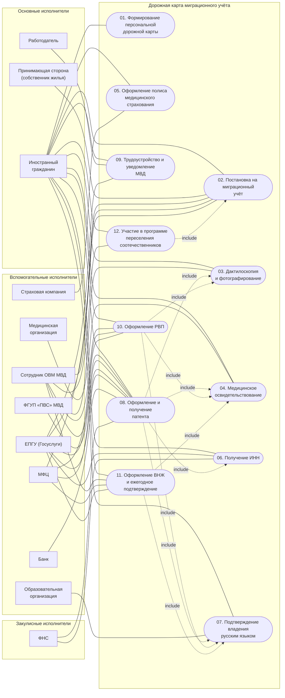

# Диаграмма прецедентов

Mermaid не поддерживает нативный UML use case, поэтому диаграмма построена как направленный граф:
акторы — прямоугольные узлы в группах по типу, прецеденты — узлы-«эллипсы» (`([ ])`) внутри
границы системы. Сплошная линия без стрелки — ассоциация «актор — прецедент»,
пунктир со стрелкой `include` — обязательное включение.

## Пояснения к связям

- **`include` у П08 (патент).** Комплект на патент по дорожной карте всегда содержит результат
  дактилоскопии и фотографирования (п. 2), медицинское заключение (п. 3.1), ИНН (п. 5.3) и
  сертификат о владении русским языком (п. 5.1). Если у ИГ есть основание освобождения
  (аттестат до 1991 г., диплом РФ, статус ВКС, участник программы переселения), соответствующий
  включаемый прецедент не выполняется — это описано в альтернативных сценариях П08.
- **`include` у П10 и П11 (РВП, ВНЖ).** Медицинские и языковые документы входят в комплект
  по п. 10.1 и п. 11.1.
- **`include` у П12 (программа переселения).** Постановка на миграционный учёт (п. 1.5)
  выполняется в срок 30 дней и является предусловием постановки на учёт участника программы.
- **П09 не связан с П08 отношением `include`.** Трудоустройство возможно и без патента
  (ВКС, РВП, ВНЖ, граждане ЕАЭС), поэтому зависимость «патент → договор» зафиксирована
  в предусловиях и альтернативных сценариях П09, а не в структуре диаграммы.
- **Обобщений между акторами нет намеренно.** «Сотрудник ОВМ» и «ФГУП ПВС» — разные
  организации с разными интерфейсами, хотя обе принимают документы; объединять их в
  одного актора значило бы потерять различие каналов подачи.

PlantUML-версия той же диаграммы: [`usecase-diagram.puml`](usecase-diagram.puml).
