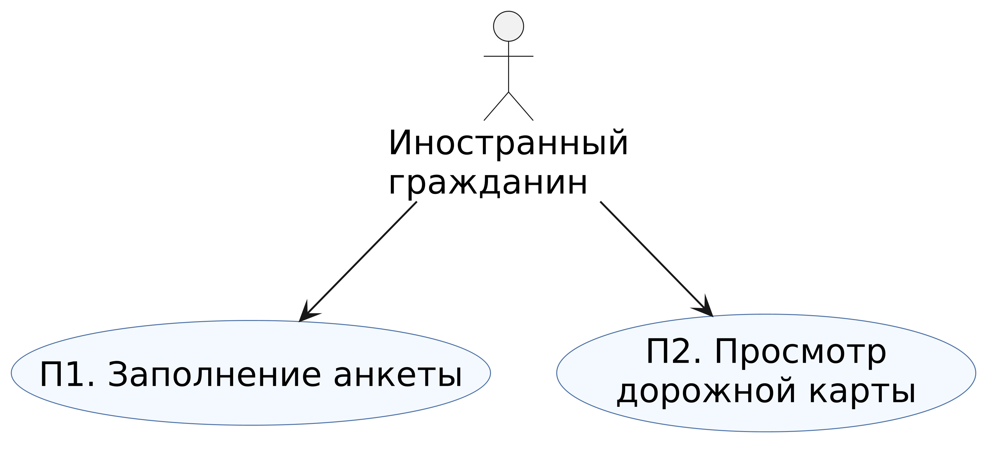

# Лабораторная 1. Прецеденты

Функциональное моделирование систем, ТюмГУ, 5 семестр.
Малышева Елена, Макеев Глеб.
Тема 7: действия после получения патента.

| Пункт дорожной карты | Что нужно сделать | Срок |
|---|---|---|
| 7.1 | трудоустроиться | 2 месяца с даты выдачи патента |
| 7.2 | направить в МВД уведомление с копией договора | после договора, не позднее 2 месяцев с даты выдачи патента |

Номера пунктов нужны только для связи с дорожной картой. В сценариях и сообщениях используем
названия: «Трудоустройство» и «Уведомление МВД».

## Исполнитель

| Исполнитель | Роль |
|---|---|
| Иностранный гражданин | заполняет анкету и смотрит дорожную карту |

## Прецеденты

| ID | Прецедент | Цель исполнителя |
|---|---|---|
| П1 | Заполнение анкеты | передать системе данные о патенте и договоре |
| П2 | Просмотр дорожной карты | узнать, что сделать и к какому сроку |

Обязанности разделены. П1 отвечает только за сбор данных. Все правила раздела 7 находятся в П2,
поэтому изменение срока затрагивает только П2.

## П1. Заполнение анкеты

**Описание.** Исполнитель вносит сведения о выданном патенте и о договоре. Система проверяет данные
и сохраняет их. Анкету можно дополнить позже, когда договор будет заключён. Сроки здесь не считаются.

**Предусловия.** Патент выдан, раздел 6 дорожной карты выполнен.

### Данные анкеты

| Поле | Обязательное | Когда заполняется |
|---|---|---|
| Серия и номер патента | да | всегда |
| Дата выдачи | да | всегда |
| Регион | да | всегда |
| Профессия | да | всегда |
| Вид договора: трудовой или договор гражданско-правового характера (ГПХ) | нет | только если договор заключён, вместе с датой |
| Дата заключения | нет | только если договор заключён, вместе с видом |

Поля про договор необязательные. Договора нет, значит оба остаются пустыми, и система считает, что
трудоустройства нет. Но заполнять их можно только парой: вид без даты или дата без вида не пройдут
проверку.

Система не проверяет, существует ли договор в действительности. Она не видит ни работодателя, ни
сам документ, поэтому доверяет тому, что ввёл исполнитель, и проверяет только согласованность
данных. Это граница подсистемы: она рекомендует, а не подтверждает факты.

### Основной сценарий 1.1

| № | Действия исполнителя | Отклик системы |
|---|---|---|
| 1 | Открывает анкету | |
| 2 | | Показывает поля анкеты по таблице выше. Обязательные помечает знаком «*» |
| 3 | Заполняет поля | |
| 4 | | Проверяет обязательные поля, формат дат и что договор заполнен целиком: либо оба поля, либо ни одного. Ошибок нет, сообщение не выводит |
| 5 | Подтверждает анкету | |
| 6 | | Пишет: «Анкета сохранена. Перейти к дорожной карте?» |

### Альтернативные сценарии

- **1.2. Данные некорректны.** Не заполнено обязательное поле, договор заполнен наполовину или дата
  позже сегодняшней. Система не принимает анкету и пишет: «Заполните поле: <название поля>» или
  «Дата не может быть позже сегодняшней».
- **1.3. Договор заключён позже.** Исполнитель снова открывает анкету и указывает вид договора и дату
  заключения. Система сохраняет изменения, после чего в карте появляется пункт «Уведомление МВД».
  Срок не меняется, он отсчитывается от даты выдачи патента, а статус пункта «Трудоустройство»
  становится «выполнен» или «выполнен с просрочкой».

**Постусловия.** Создан экземпляр патента, связанный с исполнителем. Если указан договор, создан
экземпляр договора, связанный с патентом. При повторном заполнении данные обновлены.

## П2. Просмотр дорожной карты

**Описание.** Система по данным П1 формирует пункты «Трудоустройство» и «Уведомление МВД» и показывает их со сроками. Все правила
раздела 7 находятся в этом прецеденте. Система ничего не отслеживает и прогресс не хранит: она
сравнивает даты из анкеты с сегодняшним днём и по ним определяет статус пункта. Срок обоих пунктов
считается от даты выдачи патента и не меняется от того, когда заполнена анкета или заключён договор.
При повторном открытии карты срок остаётся тем же, а статусы пересчитываются заново. Действия исполнитель
выполняет сам: трудоустройство и отправку уведомления в МВД через Госуслуги или по почте. Систему
уведомление не отправляет.

**Предусловия.** Анкета П1 принята, патент учтён в системе.

### Основной сценарий 2.1

| № | Действия исполнителя | Отклик системы |
|---|---|---|
| 1 | Запрашивает дорожную карту | |
| 2 | | Берёт данные из анкеты П1 |
| 3 | | Проверяет по анкете, заключён ли договор и в какую дату |
| 4 | | Формирует пункт «Трудоустройство». Договора нет: «Вам необходимо трудоустроиться. Срок: до даты выдачи патента + 2 месяца». Договор заключён в срок: «Трудоустройство выполнено: договор от <дата заключения>» |
| 5 | | Если договор указан, формирует пункт «Уведомление МВД»: «Направить в МВД уведомление с копией договора через Госуслуги или по почте. Срок: до даты выдачи патента + 2 месяца». Договора нет: «Пункт «Уведомление МВД» появится после заключения договора» |
| 6 | | Показывает карту со сроками и статусами |

В основном сценарии сроки ещё не нарушены. Случаи, когда договор заключён позже срока или срок
уведомления уже прошёл, описаны в альтернативах 2.2, 2.3 и 2.4.

### Альтернативные сценарии

- **2.2. Договор заключён позже двух месяцев с даты выдачи патента.** Пункт получает статус «выполнен с просрочкой»,
  система пишет: «Договор заключён позже срока: он должен был быть заключён не позднее даты выдачи
  патента + 2 месяца». Пункт
  «Уведомление МВД» при этом создаётся сразу со статусом «срок истёк», потому что крайний срок у него
  такой же.
- **2.3. Договора нет, прошло больше двух месяцев с даты выдачи патента.** Пункт получает статус «срок истёк», система пишет:
  «Срок истёк: с даты выдачи патента прошло больше двух месяцев».
- **2.4. Уведомление не отправлено, прошло больше двух месяцев с даты выдачи патента.** Пункт «Уведомление МВД» получает статус «срок истёк», система пишет: «Срок уведомления
  истёк: с даты выдачи патента прошло больше двух месяцев. Проверьте, направлено ли уведомление».

**Постусловия.** Созданы экземпляры пунктов «Трудоустройство» и, если указан договор, «Уведомление МВД». Каждый связан с
патентом. Статус не сохраняется, он вычисляется при показе карты.
