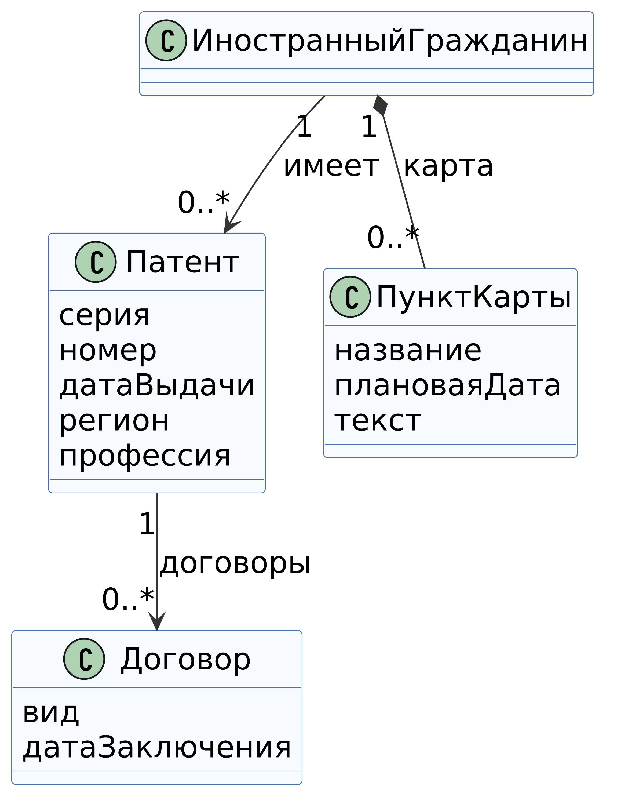

# Лабораторная 2. Модель предметной области

Функциональное моделирование систем, ТюмГУ, 5 семестр.
Малышева Елена, Макеев Глеб.
Тема 7: действия после получения патента.

## Что моделируется

Модель строится по прецедентам лабораторной 1: П1 «Заполнение анкеты» и П2 «Просмотр дорожной
карты». В модели только понятия, которые встречаются в сценариях.

## Классы

| Класс | Атрибуты | Смысл |
|---|---|---|
| Иностранный гражданин | нет | владелец патентов и карты; сценарии не запрашивают его данных |
| Патент | серия, номер, дата выдачи, регион, профессия | право работать; от даты выдачи считаются сроки |
| Договор | вид, дата заключения | договор, с которым связан патент; вид: трудовой или договор гражданско-правового характера (ГПХ) |
| Пункт карты | название, плановая дата, текст | одна строка дорожной карты: что сделать и до какого срока. Название: «Трудоустройство», «Уведомление МВД» или другой пункт карты. Текст: что именно сделать; у «Уведомления МВД» это готовый шаблон письма. Статус не хранится, он вычисляется при показе |

Идентификаторы и модификаторы доступа не указываются, методов у классов нет: это этап анализа.

## Связи и кратности

Кратность показывает, сколько объектов одного класса связано с одним объектом другого.

| Связь | Кратность | Смысл |
|---|---|---|
| Иностранный гражданин → Патент | 1 к 0..* | патентов может быть несколько, сейчас может не быть ни одного |
| Патент → Договор | 1 к 0..* | у патента может быть несколько договоров: совместительство или смена работодателя |
| Иностранный гражданин → Пункт карты | 1 к 0..* | композиция: карта принадлежит человеку, а не патенту; в ней столько пунктов, сколько требует дорожная карта |

Закрашенный ромб у гражданина означает композицию: карта не существует без человека.

## Решения

1. Четыре класса. Работодатель, уведомление МВД и документы не встречаются ни в одном сценарии
   лабораторной 1, поэтому в модель не входят. Напоминание о сроке тоже не класс: это правило
   показа карты, а не отдельный объект.
2. Подклассов у договора нет. Трудовой договор и договор ГПХ отличаются только видом, поэтому вид
   хранится атрибутом. По 115-ФЗ оба вида это трудовая деятельность с одинаковыми сроками, значит
   правила от вида не расходятся. Отдельные классы без своих атрибутов не добавляют смысла.
3. Иностранный гражданин без атрибутов. Анкета П1 его данных не запрашивает, он определяется как
   владелец патентов и карты.
4. Регион и профессия остаются атрибутами патента, отдельные справочники не нужны.
5. Пункты карты «Трудоустройство» и «Уведомление МВД» соответствуют пунктам 7.1 и 7.2 дорожной
   карты. В остальном тексте номера не используем: пользователь видит действия, а не номера. Карта
   принадлежит гражданину, а не патенту: часть пунктов выполняется до получения патента, например
   «Получить патент», поэтому пункт не может зависеть от патента. Плановая дата хранится в самом
   пункте: её считают по тем данным, которых требует пункт, а не по одному общему правилу.
6. Статус пункта карты и остаток дней вычисляются по датам анкеты и сегодняшнему дню, поэтому система не хранит
   прогресс исполнителя и не требует отметок о выполнении.
7. Число договоров не ограничено: закон не запрещает совместительство и смену работодателя. Поэтому
   у патента 0..* договоров. На число пунктов это не влияет: срок у всех договоров один, поэтому
   «Уведомление МВД» остаётся одной строкой, в которой сказано отправить уведомление по каждому
   договору.
8. Ограничение по сроку записано словами: договор заключается не позднее двух месяцев с даты выдачи
   патента.
9. Шаблон уведомления хранится текстом пункта. Данные патента и договора в него подставлены, а ФИО,
   работодатель и адресат остаются пропусками: анкета их не запрашивает, и система не должна их
   придумывать.

## Что осталось за рамками

- Диаграммы последовательностей и описания операций: лабораторная 3.
