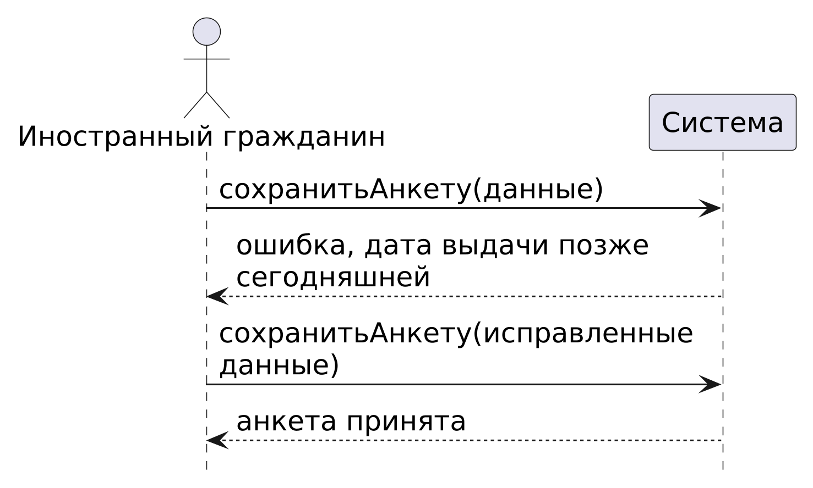
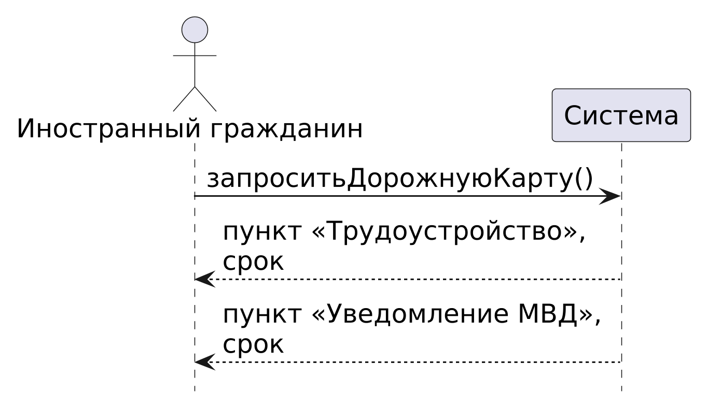
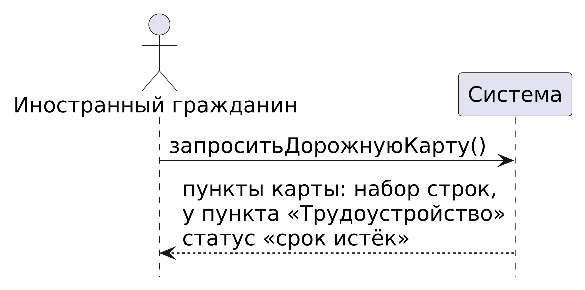

# Лабораторная 3. Системные диаграммы последовательностей

Функциональное моделирование систем, ТюмГУ, 5 семестр.
Малышева Елена, Макеев Глеб.
Тема 7: действия после получения патента.

## Исходные данные

Диаграммы строятся по сценариям лабораторной 1. Система показывается как «чёрный ящик»: на
диаграммах есть только исполнитель, система и системные события. Внутренние объекты появятся на
следующих этапах.

Системные события:

| Событие | Прецедент | Смысл |
|---|---|---|
| сохранитьАнкету | П1 | принять и сохранить данные патента и договора |
| запроситьДорожнуюКарту | П2 | построить пункты 7.1 и 7.2 со сроками |

## П1. Заполнение анкеты, сценарий 1.1

Событие одно: исполнитель передаёт данные, система их сохраняет. Проверка полей входит в
обязанности системы и не показывается отдельным событием.

## П1. Альтернатива 1.3: ошибка в данных

Ввод повторяется после сообщения об ошибке. Отдельного события для исправления не вводится.

<!-- pagebreak -->

## П2. Просмотр дорожной карты, сценарий 2.1

Система возвращает два пункта: 7.1 со сроком трудоустройства и 7.2 со сроком уведомления. Оба
срока считаются от даты выдачи патента.

## П2. Альтернатива 2.2: срок истёк

Пункт остаётся в карте, но со статусом «срок истёк». Система не скрывает нарушение, а
предупреждает о риске для патента.

## Описания операций

### Операция сохранитьАнкету

| Раздел | Содержание |
|---|---|
| Параметры | серия, номер, дата выдачи, регион, профессия, вид договора, дата заключения |
| Ссылки | прецедент П1 (сценарии 1.1, 1.3) |
| Предусловия | патент выдан |
| Постусловия | создан экземпляр патента, связанный с гражданином; если указан договор, создан экземпляр договора, связанный с патентом |

### Операция запроситьДорожнуюКарту

| Раздел | Содержание |
|---|---|
| Параметры | нет |
| Ссылки | прецедент П2 (сценарии 2.1, 2.2) |
| Предусловия | анкета П1 принята, патент учтён в системе |
| Постусловия | созданы экземпляры пункта карты 7.1 и, если указан договор, пункта 7.2; каждый связан с патентом |

Постусловия описывают изменения состояния модели: создание экземпляров и образование связей.
Показ карты на экране постусловием не является, это результат интерфейса.

## Что осталось за рамками

- Диаграммы коммуникаций и классы проектирования в эту работу не входят.
