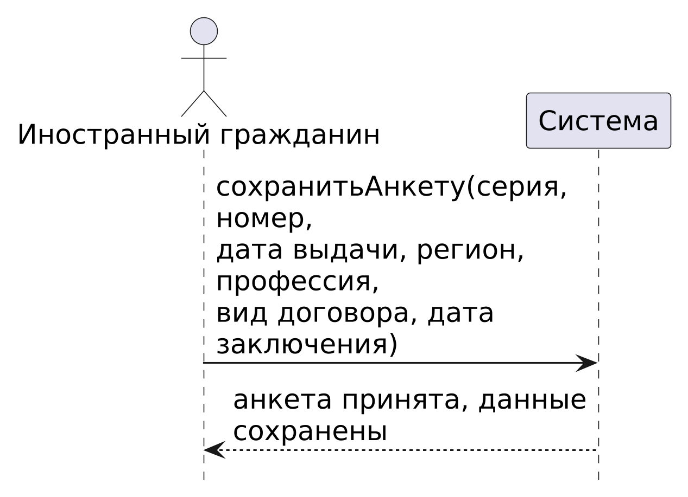

# Лабораторная 3. Системные диаграммы последовательностей

Функциональное моделирование систем, ТюмГУ, 5 семестр.
Малышева Елена, Макеев Глеб.
Тема 7: действия после получения патента.

## Исходные данные

Диаграммы строятся по сценариям лабораторной 1. Система показывается как «чёрный ящик»: на
диаграммах есть только исполнитель, система и системные события. Внутренние объекты появятся на
следующих этапах.

Системные события:

| Событие | Прецедент | Смысл |
|---|---|---|
| сохранитьАнкету | П1 | принять и сохранить данные патента и договора |
| запроситьДорожнуюКарту | П2 | вернуть карту: набор пунктов со сроками |

## П1. Заполнение анкеты, сценарий 1.1

Событие одно: исполнитель передаёт данные, система их сохраняет. Проверка полей входит в
обязанности системы и не показывается отдельным событием.

**Спецификация**

| Сценарий | Событие | Ответ системы |
|---|---|---|
| П1, основной (1.1) | сохранитьАнкету(данные анкеты) | анкета принята, данные сохранены |

## П1. Альтернатива 1.3: договор заключён позже

Исполнитель повторно сохраняет анкету, уже с договором. Срок не меняется, а в карте после этого
появляется пункт «Уведомление МВД».

**Спецификация**

| Сценарий | Событие | Ответ системы |
|---|---|---|
| П1, альтернатива (1.3) | сохранитьАнкету(вид договора, дата заключения) | анкета обновлена |

## П2. Просмотр дорожной карты, сценарий 2.1

Система отвечает одним сообщением: возвращает массив пунктов карты. Длина массива зависит от
данных: без договора в карте только «Трудоустройство», с договором добавляется «Уведомление МВД».
Каждый элемент несёт название, срок, статус, остаток дней и текст пункта; у «Уведомления МВД» текст
это шаблон письма, где ФИО и работодатель остаются пропусками.

**Спецификация**

| Сценарий | Событие | Ответ системы |
|---|---|---|
| П2, основной (2.1) | запроситьДорожнуюКарту() | ПунктКарты[], массив пунктов |

## П2. Альтернатива 2.3: договора нет, прошло больше двух месяцев

В массиве у пункта «Трудоустройство» статус «срок истёк»: прошло больше двух месяцев с даты выдачи
патента, а договор так и не указан. Отдельного сообщения об этом нет, статус это поле элемента.
Решение об аннулировании патента принимает МВД, а не система.

**Спецификация**

| Сценарий | Событие | Ответ системы |
|---|---|---|
| П2, альтернатива (2.3) | запроситьДорожнуюКарту() | ПунктКарты[], у «Трудоустройства» статус «срок истёк» |

## Описания операций

### Операция сохранитьАнкету

| Раздел | Содержание |
|---|---|
| Параметры | серия, номер, дата выдачи, регион, профессия, вид договора, дата заключения |
| Ссылки | прецедент П1 (сценарии 1.1, 1.3) |
| Предусловия | патент выдан |
| Постусловия | создан экземпляр патента, связанный с гражданином; если указан договор, создан экземпляр договора, связанный с патентом |

### Операция запроситьДорожнуюКарту

| Раздел | Содержание |
|---|---|
| Параметры | нет |
| Ссылки | прецедент П2 (сценарии 2.1, 2.3) |
| Предусловия | анкета П1 принята, патент учтён в системе |
| Постусловия | созданы экземпляры пункта «Трудоустройство» и, если указан договор, пункта «Уведомление МВД»; каждый связан с гражданином |

Статус пункта карты операция не записывает: он вычисляется при показе карты по датам анкеты.
Показ карты постусловием не является: это работа интерфейса, а не изменение данных.
