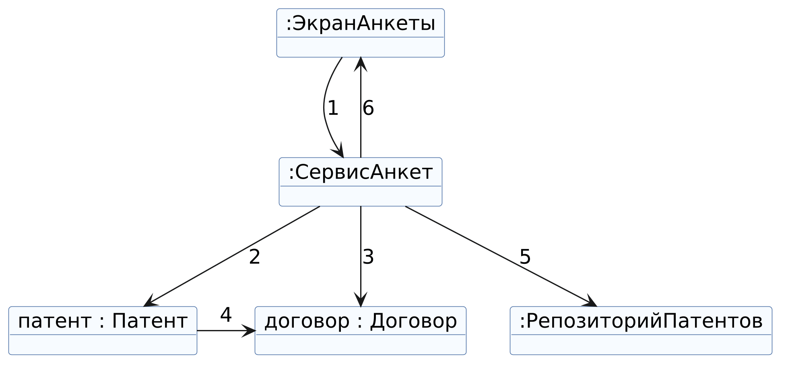
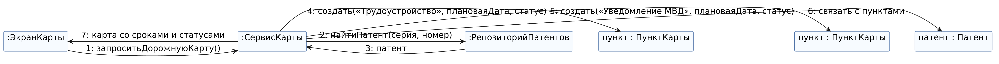

# Лабораторная 4. Диаграммы коммуникаций

Функциональное моделирование систем, ТюмГУ, 5 семестр.
Малышева Елена, Макеев Глеб.
Тема 7: действия после получения патента.

## Исходные данные

Берём системные операции из лабораторной 3. Их две, поэтому диаграмм тоже две: на каждую системную
функцию, как требует задание.

| Операция | Прецедент |
|---|---|
| сохранитьАнкету | П1 «Заполнение анкеты» |
| запроситьДорожнуюКарту | П2 «Просмотр дорожной карты» |

Объекты на диаграммах те же, что появятся классами в лабораторной 5: экран, сервис, сущности,
хранилище. Цифры на стрелках это номера сообщений, их расшифровка в таблице под каждой диаграммой.

## Операция сохранитьАнкету

| № | Кто | Кому | Сообщение |
|---|---|---|---|
| 1 | ЭкранАнкеты | СервисАнкет | сохранитьАнкету(данные) |
| 2 | СервисАнкет | Патент | создать(серия, номер, датаВыдачи, регион, профессия) |
| 3 | СервисАнкет | Договор | создать(вид, датаЗаключения) |
| 4 | СервисАнкет | Патент | связать с договором |
| 5 | СервисАнкет | РепозиторийПатентов | сохранить(патент) |
| 6 | СервисАнкет | ЭкранАнкеты | анкета сохранена |

Договор создаётся только если он указан. Если нет, шаги 3 и 4 пропускаются, остальные выполняются
как обычно.

## Операция запроситьДорожнуюКарту

| № | Кто | Кому | Сообщение |
|---|---|---|---|
| 1 | ЭкранКарты | СервисКарты | запроситьДорожнуюКарту() |
| 2 | СервисКарты | РепозиторийПатентов | найтиПатент(серия, номер) |
| 3 | РепозиторийПатентов | СервисКарты | патент |
| 4 | СервисКарты | ПунктКарты | создать(«Трудоустройство», плановаяДата) |
| 5 | СервисКарты | ПунктКарты | создать(«Уведомление МВД», плановаяДата) |
| 6 | СервисКарты | Патент | связать с пунктами |
| 7 | СервисКарты | ЭкранКарты | карта со сроками и статусами |

Пункт «Уведомление МВД» создаётся только если договор указан.

## Согласование с лабораторной 3

Каждая операция из лабы 3 превращается в одну диаграмму: первое сообщение это событие актора, ответ
последним сообщением возвращает результат. Внутренние проверки сроков не показаны отдельными
сообщениями, они входят в работу сервиса.

## Решения

1. Четыре вида участников: граница, управление, сущность, хранилище. Так объекты лабы 4 сразу
   превращаются в классы лабы 5 без переименований.
2. Сущности называются так же, как в модели предметной области: патент, договор, пункт карты.
3. Хранилище одно, `РепозиторийПатентов`: патент хранит ссылку на договор и пункты карты.
