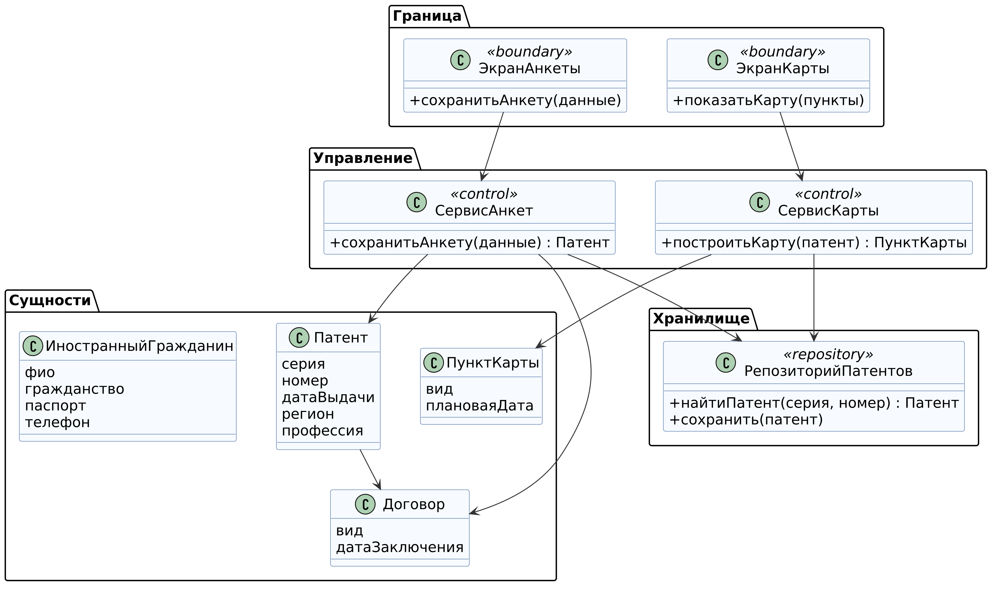

# Лабораторная 5. Классы проектирования

Функциональное моделирование систем, ТюмГУ, 5 семестр.
Малышева Елена, Макеев Глеб.
Тема 7: действия после получения патента.

## Исходные данные

Классы собираются из диаграмм коммуникаций лабораторной 4: каждый объект становится классом, каждое
сообщение становится методом. Ничего нового не придумываем.

## Состав модели

| Слой | Класс | Что делает |
|---|---|---|
| Граница | ЭкранАнкеты | принимает данные и передаёт их сервису |
| Граница | ЭкранКарты | показывает пункты карты |
| Управление | СервисАнкет | сохраняет анкету: создаёт патент, договор, связывает их |
| Управление | СервисКарты | строит пункты карты по патенту и договору |
| Сущность | ИностранныйГражданин | владелец патента |
| Сущность | Патент | серия, номер, дата выдачи, регион, профессия |
| Сущность | Договор | вид и дата заключения |
| Сущность | ПунктКарты | вид, плановая дата |
| Хранилище | РепозиторийПатентов | поиск и сохранение патента |

## Согласование с лабораторной 4

| Объект лабы 4 | Класс лабы 5 | Сообщение лабы 4 | Метод лабы 5 |
|---|---|---|---|
| :ЭкранАнкеты | ЭкранАнкеты | сохранитьАнкету(данные) | сохранитьАнкету(данные) |
| :СервисАнкет | СервисАнкет | создать, связать, сохранить | сохранитьАнкету(данные): Патент |
| :ЭкранКарты | ЭкранКарты | запроситьДорожнуюКарту() | показатьКарту(пункты) |
| :СервисКарты | СервисКарты | найти, создать, связать | построитьКарту(патент): ПунктКарты |
| :РепозиторийПатентов | РепозиторийПатентов | найтиПатент, сохранить | найтиПатент(серия, номер), сохранить(патент) |

## Решения

1. Сущности оставлены без методов: у них только атрибуты, поведение находится в сервисах. Так модель
   проектирования не расходится с моделью предметной области из лабораторной 2.
2. Методы названы по-русски, как и операции: сохранитьАнкету, построитьКарту. Привязки к языку
   реализации нет, ни одного типа из Python или Java.
3. Хранилище одно. Поиск и сохранение патента этого достаточно: договор и пункты доступны через
   патент.
4. Наследования нет: экраны, сервисы, сущности и хранилище не подменяют друг друга, поэтому общий
   родитель только усложнил бы модель.

## Что осталось за рамками

- Программная реализация: лабораторная 6.
